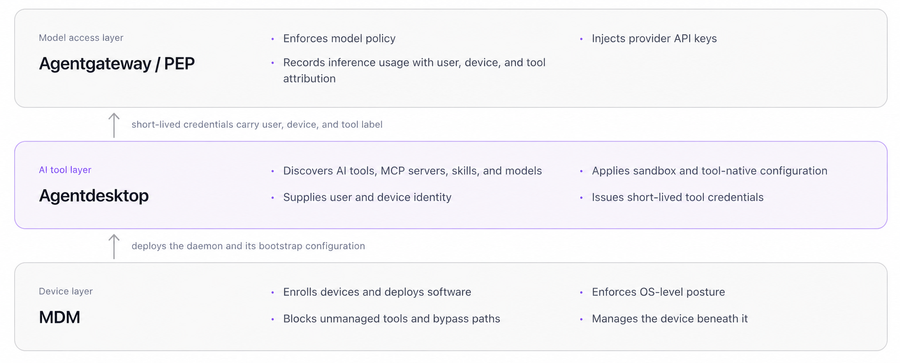
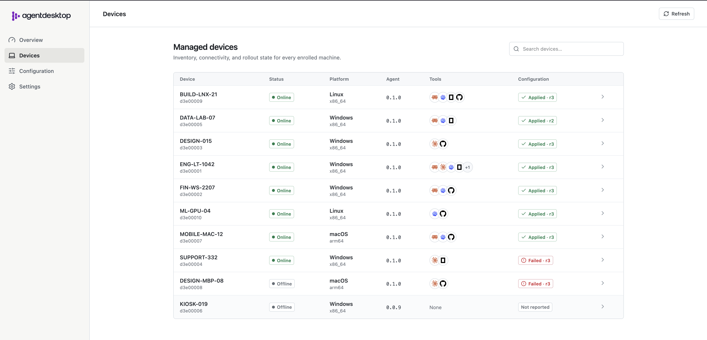
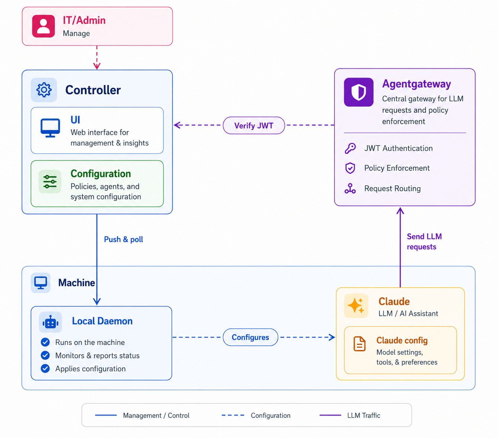

<picture>
  <source media="(prefers-color-scheme: dark)" srcset="images/logo-light.svg">
  
</picture>

# Open-source visibility and control for AI tools across your desktop fleet

[](https://github.com/agentdesktop-dev/agentdesktop/actions/workflows/ci.yml)
[](https://github.com/agentdesktop-dev/agentdesktop/releases/latest)
[](LICENSE)
[](https://github.com/agentdesktop-dev/agentdesktop)
[](https://discord.com/invite/uKX2FvCVpS)

Agentdesktop discovers AI developer tools, inventories MCP servers and skills,
applies tool-native configuration and sandbox policy, and connects each device
to an LLM gateway with user and device identity.

Keep developers in Claude Code, Codex, Cursor, OpenCode, VS Code, and Grok Build
while giving platform teams one place to understand and manage the fleet.

[Website](https://agentdesktop.dev) ·
[Documentation](https://agentdesktop.dev/docs/) ·
[Announcement](https://agentdesktop.dev/blog/2026/09/introducing-agentdesktop/) ·
[Releases](https://github.com/agentdesktop-dev/agentdesktop/releases)

## Why Agentdesktop?

AI agents increasingly run on employee workstations, but the controls around
them are fragmented across tool-specific settings, MCP connections, skills,
provider credentials, and local configuration files.

MDM remains the right layer for enrolling devices, deploying software, and
enforcing OS posture. Agentdesktop adds the AI-tool-aware layer above it.

| See what is running | Manage tools natively | Control model access |
| --- | --- | --- |
| Discover supported tools and versions, then inventory MCP servers, skills, and models without collecting their secrets or contents. | Define configuration and sandbox intent once. Agentdesktop translates it into each supported tool's native format and reports whether it was applied. | Route tools through your LLM gateway with short-lived credentials carrying user, device, and allowed client context. Provider API keys remain at the gateway. |



## Start on one workstation

Try the same endpoint daemon used in a managed fleet without deploying a
controller.

### 1. Install Agentdesktop

Download the current device binary from
[GitHub Releases](https://github.com/agentdesktop-dev/agentdesktop/releases), or
build it from source:

```sh
git clone https://github.com/agentdesktop-dev/agentdesktop.git
cd agentdesktop
corepack enable
make install
```

#### Linux without a desktop (RHEL 8, WSL, VDI)

The `agentdesktop-linux-*` binaries include the desktop UI and need GTK,
WebKitGTK 4.1, and glibc 2.34 or later. On hosts without them, such as RHEL 8,
WSL, and virtual desktops, use `agentdesktop-headless-linux-*` instead. It runs
the same daemon and command-line tools without the UI. It is statically linked,
so it does not depend on the host's glibc or other system libraries:

```sh
curl -fLO https://github.com/agentdesktop-dev/agentdesktop/releases/latest/download/agentdesktop-headless-linux-amd64
install -D -m 0755 agentdesktop-headless-linux-amd64 ~/.local/bin/agentdesktop
agentdesktop --version
```

Every `agentdesktop` command in this guide works with the headless binary.
`agentdesktop daemon --user` reads `~/.config/agentdesktop/config.yaml` (or
`$XDG_CONFIG_HOME/agentdesktop/config.yaml`) and does not start without it.
Create that file first, for example from
[`examples/standalone/config.yaml`](examples/standalone/config.yaml):

```sh
mkdir -p ~/.config/agentdesktop
curl -fL -o ~/.config/agentdesktop/config.yaml \
  https://raw.githubusercontent.com/agentdesktop-dev/agentdesktop/main/examples/standalone/config.yaml
```

Edit it for your identity provider and gateway. To keep a user-mode daemon
running, create a systemd user unit at
`~/.config/systemd/user/agentdesktop.service` (on WSL, first set
`systemd=true` under `[boot]` in `/etc/wsl.conf`):

```ini
[Unit]
Description=Agentdesktop daemon

[Service]
ExecStart=%h/.local/bin/agentdesktop daemon --user
Restart=on-failure

[Install]
WantedBy=default.target
```

```sh
systemctl --user daemon-reload
systemctl --user enable --now agentdesktop
agentdesktop status
agentdesktop enrollment
```

When the daemon cannot open a browser, it prints the sign-in URL. Open that URL
in any browser on the same machine (on WSL, the Windows browser reaches the
daemon's `localhost` callback). `agentdesktop login` uses device authorization
and works from any device.

### 2. Preview the standalone example

The repository includes a working standalone configuration for Claude Code,
OIDC, and Agentgateway. Preview every proposed file action without changing
tool configuration:

```sh
agentdesktop daemon \
  --config examples/standalone/config.yaml \
  --user \
  --dry-run
```

### 3. Run and inspect

Remove `--dry-run` to reconcile the configuration and leave the daemon
running:

```sh
export ANTHROPIC_API_KEY=sk-ant-...
docker compose -f examples/standalone/compose.yaml up -d

agentdesktop daemon \
  --config examples/standalone/config.yaml \
  --user
```

In another terminal, check the daemon and list discovered tools and models:

```sh
agentdesktop status
agentdesktop discover
```

The desktop and fleet interfaces also expose the MCP server and skill
inventory. See the [standalone quickstart](https://agentdesktop.dev/docs/getting-started/standalone/)
for prerequisites, test credentials, and a walkthrough of the local services.

## Local LLM proxy

For clients without an API-key helper, enable the daemon's optional loopback proxy
in the local configuration file (startup settings are local only, not delivered by
the controller). The proxy is available in `--user` mode only: it hands out the
current user's gateway credential, so a system daemon rejects
`daemon.llmProxy.listen`. If the address cannot be bound at startup, the daemon
keeps running without the proxy and reports `llmProxy.bound: false` with the
reason in daemon-info (the desktop app's "Daemon information" panel, or
`curl --unix-socket <socket> http://localhost/v1/daemon-info`). If the proxy
stops later, the daemon also keeps running; that is only visible in the daemon
log until the next restart:

```yaml
daemon:
  llmProxy:
    listen: 127.0.0.1:4000
```

Then start the daemon as usual:

```sh
agentdesktop daemon --user --config <your-config>.yaml
```

Point the client's model endpoint at `http://127.0.0.1:4000/v1/chat/completions`,
`/v1/messages`, or `/v1/responses`, according to the protocol it uses, and give it
the pairing header (see **Pairing** below). The proxy forwards request bodies
(buffered, see below) to `llmGateway.proxyUrl` (or `llmGateway.url` when unset),
streams the response back, and adds the credential from the same authentication
flow used by the daemon's API-key helpers. Login and refresh stay with the
existing authentication implementation. No client API key is needed. Incoming
authorization/API-key headers are replaced, and upstream HTTP errors and
redirects are passed back without following redirects.

The incoming path and query are appended to the gateway base URL: with
`llmGateway.proxyUrl: https://gateway.example/prefix` (or `url`, when `proxyUrl`
is unset), `/v1/messages` goes to `https://gateway.example/prefix/v1/messages`.
Avoid repeating `/v1` in both URLs.

**Without the proxy.** When the daemon runs without its loopback proxy
(`daemon.llmProxy.listen` unset, or the address could not be bound),
`llmGateway.whenProxyUnavailable` decides what happens to the files of the
programs that use the proxy (`programs.copilot`, `programs.vscode`). With
`failClosed`, the default, the daemon leaves their managed entries as they
are: the Copilot CLI and VS Code stay pointed at the loopback port, and those
requests fail instead of reaching GitHub past the gateway. This needs entries
to be in place: on a first apply without the proxy, or after the entries were
removed by hand, nothing points at the loopback port, so VS Code on GitHub's
models talks to GitHub directly and the Copilot CLI and VS Code on own models
have no gateway models; the status says so. If the address could
not be bound because another process holds it, that process receives those
requests, with VS Code's Copilot tokens and the pairing value: use the default
on devices with a single user, as for the proxy in general. With
`failOpen`, the daemon removes the entries until the proxy is back: VS Code on
GitHub's models then talks to GitHub directly, and the Copilot CLI and VS Code
on own models lose the gateway's models. Either way the programs report
`inactive` with the reason, and the next apply with the proxy writes the
current entries. A stopped daemon changes no file, so the tools fail until it
runs again, whatever the policy. The policy covers only the files the daemon
writes: whether developers can reach GitHub's models without the gateway is
set by the organisation's Copilot policy and egress rules. Set the key only
after the controller and the daemons run a version that knows it; older ones
reject a configuration that carries it.

```yaml
llmGateway:
  url: https://gateway.example.com
  whenProxyUnavailable: failOpen   # default failClosed
```
The proxy does not discover models or rewrite model IDs; configure those in the
client. VS Code's built-in **Custom Endpoint** provider can use this endpoint
without the experimental extension in `vscode/`. The provider reads
`chatLanguageModels.json` in the VS Code user directory (on Linux
`~/.config/Code/User/`); keep the file owner-only, since it carries the pairing
value. Give it the pairing value in the model's `requestHeaders` (the file's
`apiKey` is not sent reliably without an OS keyring):

```json
[
  {
    "name": "agentdesktop",
    "vendor": "customendpoint",
    "apiKey": "unused",
    "apiType": "chat-completions",
    "models": [
      { "id": "gpt-4.1-mini", "name": "gpt-4.1-mini (agentdesktop)",
        "url": "http://127.0.0.1:4000/v1/chat/completions",
        "toolCalling": true, "vision": false,
        "maxInputTokens": 128000, "maxOutputTokens": 16000,
        "requestHeaders": { "x-agentdesktop-pairing": "<value>" } }
    ]
  }
]
```

Upgrade note: before the pairing existed, this route accepted any local caller.
A manual setup made against that version now gets `403 pairing_invalid` until
the header is added.

Controller JWT authentication uses client ID `vscode` by default on the
prefix-less route; choose another ID with `daemon.llmProxy.clientId`. Every client
ID the proxy presents (`vscode` or your choice, plus `copilot-cli` and
`vscode-copilot` for the routes below) must be in the controller's
`allowedClientIds`, and so must the client ID of every session registered for
`/sandbox/`. With `authentication.type: oidc` the client ID has no effect: the
OIDC token is the same for every route. The listen address must be loopback.

**Routes.** Besides the prefix-less route (the manual shape used above, with the
credential mode from `llmGateway.githubOAuth` and the upstream from
`llmGateway.proxyUrl`), the proxy serves fixed path prefixes: one per managed
Copilot program route, whose client ID is decided by the file the daemon writes
and never by request headers, and `/sandbox/`, whose client ID comes from the
registered session (the route name is unrelated to the top-level `sandbox`
configuration key). The prefix is stripped before forwarding. A path whose first segment looks like a route name without matching
one exactly is refused with `404 route_unknown` rather than served as the
prefix-less route; this also applies to a gateway sub-path that happens to start
with a route name (for example `/vscode-copilot-proxy/...`), so do not use such
paths on the prefix-less route:

| Prefix | Client ID | Sends upstream | Upstream |
| --- | --- | --- | --- |
| `/copilot-cli/` | `copilot-cli` | gateway identity only | `llmGateway.url` |
| `/vscode-copilot/` | `vscode-copilot` | gateway identity only | `llmGateway.url` |
| `/vscode-copilot-passthrough/` | `vscode-copilot` | gateway identity in `Authorization`, the client's own bearer token in `x-llm-token` | `llmGateway.proxyUrl` (required) |
| `/vscode-copilot-capi/<pairing>/` | `vscode-copilot` | as the pass-through route; a credential-less `GET /_ping` is forwarded without `x-llm-token`; the only route that tunnels WebSocket upgrades | `llmGateway.proxyUrl` (required) |
| `/sandbox/` | the registered session's (see **Sandbox route and per-session pairing**) | gateway identity only | `llmGateway.url` |

**Pairing.** Every route except `/sandbox/` requires the per-device pairing
value in the `x-agentdesktop-pairing` header; `/vscode-copilot-capi/` takes it
as the first path segment after the prefix (VS Code cannot add a header there)
and ignores the header, and `/sandbox/` takes a per-session pairing in the
header instead. The daemon creates it in its state directory
(`llm-proxy-pairing`, owner-only) on first use and keeps it across restarts; a
manual setup copies it from there. The state directory in `--user` mode is
`$XDG_STATE_HOME/agentdesktop`, by default `~/.local/state/agentdesktop` (the
home directory from `HOME` or `USERPROFILE`, on every platform), unless
`daemon.stateDir` says otherwise. The Copilot CLI's
`providers.json` carries it as `"headers": {"x-agentdesktop-pairing": "<value>"}`
on the provider entry. It keeps other local users on a shared host
and browser pages off the proxy, provided the client files that carry it are
owner-only too. It does not restrict the current user's own processes, which can
obtain a credential from the daemon directly. If the value cannot be created the
proxy stays off, reported in daemon-info like a failed bind.

**Requests.** `Host` must be a loopback address; `Origin`, `CONNECT` and
`OPTIONS` are refused; `..` path segments are refused. Request bodies are
buffered (32 MiB cap) so a request can be sent once more with a fresh
credential when the gateway rejects a cached one with 401 (only when no client
token was forwarded); responses stream as they arrive, with a 600 s limit on
the response headers and no total limit on the body; a non-streaming completion
sends nothing until it is done, so the header limit bounds it too. A WebSocket
tunnel on `/vscode-copilot-capi/` is outside the header limit: it runs until a
side closes it or the gateway credential used at the upgrade expires, so a
tunnel outlives a revocation or logout for up to that credential's lifetime.
A WebSocket upgrade on any other route is refused with `400
upgrade_not_supported`; other `Upgrade` tokens are stripped and the request is
forwarded as plain HTTP.
Controller-issued credentials are cached in the daemon for at most 60 s per
client ID, and are not used within 30 s of their own expiry, nor after a logout
or re-enrollment. Concurrent requests that find no cached credential share one
controller fetch; its credential is cached as soon as it arrives and dropped
again if the gateway rejects it. The cache adds no exposure beyond the credential's own
lifetime: a token the controller has issued stays valid at the gateway until it
expires whether or not the daemon caches it, and a logout does not revoke it.
OIDC credentials are not cached. A controller that does not answer within 15 s
fails the request with `agentdesktop_credential`; an OAuth refresh in flight
ahead of the controller call is not cut off, so its result is saved. When a
client token is forwarded (pass-through, or `githubOAuth.source: request`) a
401 is returned as is and the cached gateway credential is kept. With the one
retry, the worst case for one request is the header limit (600 s), a credential
fetch (20 s) and a second header limit. Refused and failed requests
return an OpenAI-style JSON body, `{"error": {"message", "type", "code"}}`, so the
LLM clients display the message. Codes: `host_not_allowed`, `pairing_invalid`,
`browser_not_allowed`, `method_not_allowed`, `path_invalid`, `route_unknown`,
`client_credential_missing`, `upgrade_not_supported`, `body_too_large`,
`body_invalid`, `agentdesktop_credential` (no gateway credential for this device: not enrolled,
revoked, controller unreachable or slow), `agentdesktop_unavailable`,
`gateway_unreachable`, `gateway_timeout`, and on the git/egress routes
`git_host_not_allowed`, `git_upstream_unreachable`, `egress_not_supported`.

To attach the local user's GitHub App OAuth token as well, add the App's client ID
to the gateway configuration (keep the existing `authentication` block):

```yaml
llmGateway:
  url: https://gateway.example
  authentication:
    type: oidc
    issuer: https://login.microsoftonline.com/YOUR_TENANT/v2.0
    clientId: YOUR_ENTRA_CLIENT_ID
  githubOAuth:
    clientId: YOUR_GITHUB_APP_CLIENT_ID
```

Enable **Device Flow** in the GitHub App settings. With the proxy enabled, the
daemon opens an Agentdesktop sign-in page with a copyable code and a link to
GitHub. GitHub opens in another tab; the Agentdesktop page automatically shows
success or failure when authorization finishes. The client ID is configurable; no App client secret is
needed. The App's permissions and the user's Copilot access must permit the
upstream requests. This flow currently targets GitHub.com.

The proxy sends `Authorization: Bearer <gateway identity token>` and
`x-llm-token: <GitHub access token>`. Incoming values for both are discarded on
this route (with `githubOAuth.source: request`, and on the pass-through route,
the client's own token is what goes into `x-llm-token`).
The GitHub access and refresh tokens are stored in the daemon's existing secret
store, separately for each App client ID. Expiring tokens refresh automatically,
including refresh-token rotation; expired/rejected refresh credentials trigger
device authorization again. Non-expiring App user tokens are also supported.
Request bodies remain untouched. The existing Claude credential-helper flow is
unchanged; the local proxy always uses the gateway identity in `Authorization`.

### GitHub Copilot: a runnable example

[`examples/copilot`](examples/copilot/README.md) runs Dex and Agentgateway
locally and walks through the Copilot CLI, VS Code on the gateway's models and
VS Code on GitHub's models, with what to check at each step (drift,
conflicts, removal) and the settings the GitHub organisation owner controls
([`examples/copilot/github-side.md`](examples/copilot/github-side.md)).

### Managed program: GitHub Copilot CLI

`programs.copilot` makes the daemon write the Copilot CLI's BYOK provider
registry so the CLI talks to the proxy's `/copilot-cli` route with client ID
`copilot-cli`; nothing is edited by hand. User mode only (the file lives in the
user's Copilot directory), and it needs `daemon.llmProxy.listen`, a configured
`llmGateway`, and `copilot-cli` in `allowedClientIds`:

```yaml
programs:
  copilot:
    models:
      gpt-4.1:                    # the name the CLI shows: --model agentdesktop/gpt-4.1
        wireModel: gpt-4.1-mini   # what is sent to the gateway (defaults to modelId, which defaults to the key)
      claude-haiku-4.5:
        provider: agentdesktop-anthropic
        wireModel: claude-haiku-4-5
```

The file is `providers.json` in `$COPILOT_HOME` (default `~/.copilot`), or the
path in `COPILOT_PROVIDERS_CONFIG` when set. The daemon reads those variables
from its own environment, which for a service-started daemon is not the
user's shell: if the CLI is pointed elsewhere by a shell profile, set
`daemon.copilot.config` in the local startup file to the same path. The daemon
adds two provider entries, `agentdesktop` (OpenAI-compatible, base URL
`http://<listen>/copilot-cli/v1`) and `agentdesktop-anthropic` (Anthropic,
base URL `http://<listen>/copilot-cli`), both carrying the pairing header,
plus one model entry per configured model (`id` is the map key, `provider`
and `modelId` are typed fields, other keys such as `wireModel` are passed
through to the CLI). Providers and
models the user added themselves are kept, including models of their own
under other providers with the same IDs. The two provider names and the
models under them belong to the daemon once it has written the file: it
replaces them on every apply, so an edit made by hand to one of them is
undone. Before the daemon has written the file, a user provider under one of
those names (without a pairing header), or a model under such a name, is a conflict:
the file is left alone and, as for every managed file, the daemon applies
nothing on the device until the conflict is resolved (a conflict present at
startup stops the daemon from starting, as for the other programs). If the
daemon's sidecar next to the file is gone, entries under the managed names
that carry a pairing header are replaced on the next apply, and those that
carry this daemon's own pairing value are removed when the program goes
away; entries with another pairing value are left alone. While the daemon runs
without the proxy it has no pairing of its own, so any pairing value counts
(only an agentdesktop daemon writes that header). The file is written
owner-only. The
daemon's sidecar next to it (`.providers.json.agentdesktop`, owner-only) keeps
a copy of the file as last written, including the user's own providers and
their `apiKey` values, until the next apply. Removing
`programs.copilot` or setting `useLlmGateway: false` takes the managed
entries out again (running without the proxy depends on
`llmGateway.whenProxyUnavailable`, see **Without the proxy**) and restores the user's file with
its previous mode (deleted only if the daemon created it and nothing else is
left).

Upgrade note: `programs.copilot` is a new field. Upgrade the controller first
(an older controller rejects the configuration), then the daemons (an older
daemon marks a pushed configuration that carries the field as failed); push
the program only to devices that run in user mode, since a system-mode daemon
fails the whole apply for the program it cannot manage.

Pick the model with `copilot --model agentdesktop/gpt-4.1` or the `model` key
in the CLI's `settings.json` (`/model` in the CLI); the daemon does not write
that key. There is no `--dry-run` preview for this file: the proxy cannot run
in one-shot mode, so `daemon.llmProxy.listen` is refused together with
`--once` or `--dry-run`, and without the listener the daemon has nothing to
point the CLI at. A running CLI session does not pick up a changed `providers.json`;
start a new one. Each device's `providers.json` is tied to that device's
pairing value, so after a re-enrollment the daemon rewrites it on the next
apply. Discovery reports the CLI's version from the `@github/copilot` npm
manifest next to the launcher; a standalone binary shows no version. The
program cannot be applied with `--once`.

### Managed program: VS Code Copilot Chat on own models

`programs.vscode` makes the daemon write VS Code's custom language-model file
(`chatLanguageModels.json`, read by Copilot Chat's built-in **Custom
Endpoint** provider) so the model picker offers the configured models through
the proxy's `/vscode-copilot` route with client ID `vscode-copilot`. User mode
only; needs `daemon.llmProxy.listen`, a configured `llmGateway`, and
`vscode-copilot` (not the proxy's default `vscode`) in `allowedClientIds`:

```yaml
programs:
  vscode:
    copilotChat: ownModels          # or githubModels, see the next section
    models:
      gpt-4.1-mini:                 # the model name sent to the gateway
        name: GPT-4.1 mini (agentdesktop)   # picker label, defaults to "<id> (agentdesktop)"
        maxInputTokens: 128000
        maxOutputTokens: 16000
```

The file lives in the VS Code user profile directory: Linux
`~/.config/Code/User`, macOS `~/Library/Application Support/Code/User`,
Windows `<home>\AppData\Roaming\Code\User` (the daemon derives it from the
home directory, not from `APPDATA`); the local startup setting
`daemon.vscode.config` overrides it. Insiders and VSCodium profiles are not
managed.

The daemon writes one vendor entry named `agentdesktop` (`vendor:
customendpoint`, `apiType: chat-completions`) with one model per configured
entry: `id`, `name`, the `url` on the proxy, `toolCalling` (default true),
`vision` (default false), the token limits when set, and the pairing value in
`requestHeaders`; other keys are passed through. VS Code keeps the file's
`apiKey` in the OS keyring and does not send it reliably, so the placeholder
`apiKey: unused` stays and the header carries the pairing; no secret is
written.

Other vendor entries in the file are the user's and are kept. The
`agentdesktop` entry belongs to the daemon once it has written the file: it is
replaced as a whole on every apply (a hand edit, or a model added by hand
inside that entry, is undone) and removed by name on removal. Before the
first write, a user entry with that name and no pairing header is a conflict,
as for the Copilot CLI file. The file is written owner-only, plan reports
carry no content, there is no `--dry-run` preview and `--once` refuses the
program, and the upgrade note for `programs.copilot` applies (controller
first, then daemons, user-mode devices only).

VS Code reads the file at startup: restart it after an apply that changes the
file (first apply, model changes, re-pairing after a re-enrollment).
`chat.defaultModel` is not written by the daemon; set it by policy if a
default is wanted. The file must stay plain JSON: a file with comments or
trailing commas is reported as a conflict rather than rewritten without
them, and a conflict blocks every managed file on the device until it is
resolved (and stops the daemon at startup, as for the other programs); an
empty file is filled. If the daemon's sidecar next to the file is gone, an
`agentdesktop` entry carrying a pairing header is replaced on the next apply,
and one carrying this daemon's own pairing value is removed when the program
goes away (while the daemon runs without the proxy, one carrying any pairing
value). Pass-through
model keys are written as given, so a misspelt key reaches VS Code unchanged.
The daemon's sidecar next to the file (`.chatLanguageModels.json.agentdesktop`,
owner-only) keeps a copy of the file as last written, including the user's
own entries, until the next apply. Non-default VS Code profiles and
`XDG_CONFIG_HOME` are not considered, matching the MCP inventory.

### Managed program: VS Code Copilot Chat on GitHub's models through the gateway

With `copilotChat: githubModels`, VS Code keeps GitHub's own models and its own
Copilot sign-in, and the daemon routes Copilot Chat's traffic to GitHub through
the gateway. The daemon writes two keys into the VS Code user `settings.json`:
`github.copilot.advanced.debug.overrideCapiUrl`, pointing Copilot Chat's API
endpoint at the proxy's `/vscode-copilot-capi/<pairing>` route, and the two
entries `github.copilot.advanced.debug.overrideCapiUrl` and
`github.copilot.internal.capiUrl` in `settingsSync.ignoredSettings`, so
Settings Sync does not carry the override to other machines. The managed
`chatLanguageModels.json` entry is removed under this value; `models` must be
empty. Needs `llmGateway.proxyUrl` (a gateway route that forwards to GitHub with
the client's own token, see the example below), `daemon.llmProxy.listen`, user
mode, and `vscode-copilot` in `allowedClientIds`:

```yaml
llmGateway:
  url: https://gateway.example
  proxyUrl: https://gateway.example/copilot-proxy
  authentication:
    type: controllerJwt
    audience: agentgateway
    allowedClientIds: [vscode-copilot]
programs:
  vscode:
    copilotChat: githubModels
```

VS Code sends its Copilot session token (`tid=...`) as the bearer token on chat
requests and the raw GitHub OAuth token (`gho_...`) on `/agents/*`; the proxy
moves either into `x-llm-token`, puts the gateway identity into `Authorization`
and forwards to `proxyUrl`. The pairing value travels in the URL path on this
route, because VS Code sends these requests itself and has no setting that
adds a header to them; the segment is checked in constant time and removed
before forwarding, and appears in no log or plan report. Copilot Chat's health
check, `GET /_ping` every few seconds, carries no credential and is forwarded
without `x-llm-token`. Auto and agent mode open a WebSocket (`GET /responses`)
that the proxy tunnels: the gateway identity is checked once, at the upgrade,
and the tunnel stays open until either side closes it or the gateway
credential it was opened with expires (its own expiry, typically the
controller JWT's; a re-enrollment or logout does not cut an open
conversation). With the controller's default `gatewayJwt.lifetime` of 5
minutes, and a credential that may have been cached for up to 60 s, a tunnel
is closed after 4 to 5 minutes, also in the middle of a turn; whether VS Code
then reconnects without the user noticing has not been verified. A longer
lifetime lengthens the tunnel and the revocation window together. Everything else VS Code sends goes to the gateway and on to
GitHub unchanged, including its `Copilot-Session-Token` (the Auto session
token) and its machine and device ids; gateway access logs that record request
headers see them. Quota headers from GitHub pass through, so VS Code's usage
display keeps working.

The file lives in the VS Code user profile directory next to
`chatLanguageModels.json` (Linux `~/.config/Code/User/settings.json`); the
local startup setting `daemon.vscode.settings` overrides it. The daemon adds
its two keys and keeps every other setting; user entries in
`settingsSync.ignoredSettings` are kept, ours are added by value. A user's own
`overrideCapiUrl` is overwritten while the program is active and restored on
removal; `github.copilot.internal.capiUrl` is the newer alias of the same
setting and is only added to the ignore list, not written. The file is written
owner-only (an existing world-readable file is tightened, since the URL
carries the pairing) and removal keeps the mode it finds; the sidecar is
`.settings.json.agentdesktop` (owner-only, tightened the same way). VS Code
itself saves the file with its own
default mode (664 with a new inode when a setting is changed in the UI), so the
URL is readable to the group and others until the daemon's next apply
tightens it again (a config push, a daemon restart, a reconnect to the
controller, or the reconcile tick when `daemon.reconcileInterval` is set); an unchanged file
looser than 0600 is tightened on the next apply without being rewritten
otherwise. The override key is the daemon's while the program is active: a
hand edit of the URL is replaced on the next apply and is not kept as the
user's value on removal (only a value the key had before the first apply
comes back).

The daemon edits the file in place: the override and the two ignore entries
are the only text it changes (new properties go at the top of the object),
and comments, trailing commas, key order, indentation, line endings and a
leading byte-order mark stay as they are; removal takes out exactly what the apply added, so a file the
daemon only added keys to returns to its earlier content. Exceptions: a
file written on a single line (`{ "a": 1 }`) is expanded to one property per
line when keys are added and stays expanded after removal, an empty object
written over several lines comes back as `{}`, and a file that holds only
comments keeps them and gains `{}`. VS Code itself always writes one property
per line. The sidecar holds no
copy of the file, only the override's earlier value and which ignore entries
the daemon added. A sidecar the daemon cannot read (not JSON, or not a state
it knows) fails the apply like a conflict: every managed file on the device
stays untouched, also while `programs.vscode` is not configured (removal reads
the sidecar too), and the daemon does not start; without it the override's
earlier value could not be restored. Fix the sidecar, or delete it to go on
without it (the daemon then treats an override pointing at its own loopback
route as its own, and a value it replaced earlier is not restored). A
conflict (the file is not valid VS Code JSONC, meaning
anything beyond comments and trailing commas such as a missing comma or a
single-quoted string; the top level is not an object;
`settingsSync.ignoredSettings` is not an array; or a managed key appears twice)
leaves the file untouched and blocks every managed file on the device until it
is resolved (and stops the daemon at startup); fix the file in VS Code and
re-apply (with `daemon.reconcileInterval` set, the next tick applies it). Removal (program
absent, `ownModels`, `useLlmGateway: false`, no gateway, or no `proxyUrl`)
takes the key and the two entries out and deletes the file only if the daemon
created it. Without the proxy, `llmGateway.whenProxyUnavailable` decides (see
**Without the proxy** above): the default keeps the override, so Copilot Chat
fails instead of reaching GitHub directly. Restart VS Code after an apply that changes
the file (first apply, re-pairing after a re-enrollment). There is no
`--dry-run` preview: a dry run has no proxy, so it lists nothing for this file
under `failClosed` and the removal under `failOpen`; `--once`
refuses the program.

Caveats. `github.copilot.advanced.debug.overrideCapiUrl` is an undocumented
setting of the Copilot Chat extension; if a VS Code release drops it, the
fallback is VS Code's HTTP proxy setting with the gateway as the proxy, which
this program does not manage. While the daemon is not running, the override
stays in `settings.json` and VS Code keeps sending its requests to the
loopback port: they fail, and they carry the user's Copilot session token
(`tid=`), the GitHub OAuth token (`gho_`, on `/agents/*`) and the pairing
value, so another local user who binds that port in the meantime receives
them. Use the program on devices with a single VS Code user, stop VS Code (or
switch the program to `ownModels` and let the daemon apply it) before stopping
or removing the daemon, and delete the key by hand if the daemon is removed
with the override in place: Copilot Chat fails until then. Which of GitHub's
models the picker offers is decided by the organisation's Copilot policy, not
by the daemon.

Upgrade note: `copilotChat: githubModels` (which requires the existing
`llmGateway.proxyUrl`) and `daemon.vscode.settings` are new. Upgrade the
controller first, then the daemons, then push the value; an older controller
rejects the value.

A gateway route for `proxyUrl` (Solo Enterprise for AgentGateway standalone),
verified with Business seats against `api.business.githubcopilot.com`; other
plans use another host, which a signed-in VS Code shows in its Copilot Chat log
(the `_ping` requests), so take it from there before writing the route. The
route validates the controller JWT, restores the client's token as the bearer
for GitHub and forwards. The backend must speak HTTP/1.1 to GitHub (`alpn`):
with the default ALPN, GitHub answers the forwarded upgrade with `400
websocket: the client is not using the websocket protocol` and VS Code falls
back to plain `POST /responses` (turns still answer, without the WebSocket).
Its `requestTimeout` bounds request/response exchanges; an established
WebSocket tunnel is not cut by it.

```yaml
routes:
- name: copilot-proxy
  gateways: gateway
  matches:
  - path:
      pathPrefix: /copilot-proxy
  policies:
    jwtAuth:
      mode: strict
      issuer: agentdesktop-controller
      audiences: [agentgateway]
      jwks:
        url: https://<controller>/.well-known/jwks.json
    urlRewrite:
      authority:
        full: api.business.githubcopilot.com
      path:
        prefix: /
    timeout:
      requestTimeout: 120s
  backends:
  - host: api.business.githubcopilot.com:443
    policies:
      backendTLS:
        alpn: [http/1.1]   # the WebSocket upgrade cannot travel over HTTP/2
      backendAuth:
        passthrough: {}
      transformations:
        request:
          set:
            authorization: '"Bearer " + request.headers["x-llm-token"]'
          remove:
          - x-llm-token
```

This route is a pass-through, not an LLM route, so requests on it have no
token or cost records; see [Token and cost usage](#token-and-cost-usage).

## Sandboxed launch (Windows, preview)

`agentdesktop run claude` starts Claude Code inside a Windows AppContainer so the
agent sees the workspace, its own state and little else; `agentdesktop run
opencode` and `agentdesktop run copilot` do the same for OpenCode and GitHub
Copilot CLI (see **OpenCode and Copilot CLI in the box** below). The daemon drives
Microsoft's MXC executor; nothing is installed on the device by Agentdesktop
itself. Startup setting (local only, user mode):

```yaml
daemon:
  user: true
  llmProxy:
    listen: 127.0.0.1:4000
  containment:
    executor: C:\Program Files\mxc\x64\wxc-exec.exe
    # egress: allow  # opt-out of the default `deny`: the box gets open outbound
    # engine: mxc    # the sandbox engine; `mxc` is the only value
    # git:           # git over the relay (https remotes)
    #   allow: [https://github.com/your-org/]
    #   pushAllow: [https://github.com/your-org/team-repo.git]
    #   credentials:
    #     - urlPrefix: https://github.com/your-org/
    #       username: x-access-token
    #       secret: <PAT>
    #   ssh:           # git over ssh, signing through the user's ssh-agent
    #     hosts: [github.com]
    #     keys: ["SHA256:..."]   # fingerprints as `ssh-add -l` prints them
    # egressUpstream:  # chain the git leg through a central agentgateway
    #   url: https://egress.example.com
```

**Wrap mode (preview).** A top-level `containment` policy block
(controller-delivered, or in the local file on controller-less devices)
makes the boxed launch the default for a named program:

```yaml
containment:
  programs:
    claudeCode:
      executable: 'C:\Program Files\Anthropic\ClaudeCode\claude.exe'
```

`mode` defaults to `wrap`; `mode: native` is the per-program opt-out. In wrap
mode `agentdesktop run claude` launches only the configured executable
(`~\.local\bin` and PATH are not searched), `agentdesktop run --wait` returns
the launch's recorded exit code to the calling shell (the executor's code,
not the program's own), and a Windows user-mode daemon reports per-program
posture in its daemon-info under `containment.programs.<program>`: `mode`,
`executable`, `aliasesPresent`, `violations` and `lastViolationUnixSeconds`
(a report-only scan of native runs of the managed binary). A daemon that
predates this setting rejects a configuration that contains it, so upgrade
the controller and then every device before setting it in
controller-delivered policy. The managed package that installs the vendor
binary, the PATH-first `claude` launchers and the updater-off drop-in is
built from the recipe in `scripts/windows-package/`; the deployment guide is
[docs/windows-managed-package.md](docs/windows-managed-package.md).

**Egress is denied by default.** A box has no direct outbound network unless
`daemon.containment.egress: allow` is set; with `allow` the daemon logs
`egress allow: the box has unrestricted outbound` at every launch. A config
written without the key means `deny` to this daemon and `allow` to an older
one; set the key explicitly if a rollback is possible.

Under `deny` the box reaches the model through the local LLM proxy and git
remotes through the relay's `/git` route: the daemon writes a per-launch
gitconfig (`GIT_CONFIG_GLOBAL`) that rewrites every `git.allow` prefix to the
loopback relay, and the relay re-originates TLS to the remote, attaching the
matching `git.credentials` entry (longest prefix, allowed hosts only) on its own
leg; the box never sees the credential. Only the smart-HTTP endpoints are
served; a remote outside `git.allow` gets `403 git_host_not_allowed`, a push to
a remote outside `git.pushAllow` gets git's `fatal: remote error: ...`, and
upstream redirects are followed by the daemon (at most 3, only within the same
allow prefix). Allow entries are matched case-sensitively on the path and per
path element, so `team-repo` does not cover `team-repo.git`; use the remote
URL exactly as cloned, or an org prefix. Request bodies on the git route are
buffered (redirects and the retry resend them) and capped at 32 MiB; a larger
push fails with `413 body_too_large`. ssh remotes
of allowed hosts that are not in `git.ssh.hosts` get a clear refusal
(`ssh remotes are not enabled for this host; use the https remote or add the
host to daemon.containment.git.ssh.hosts`).
With `egressUpstream` set the relay sends the git requests to that endpoint
(path case preserved, `Host` = the egress host, a `503` retried once, except
on a push) instead
of to the remote; the central gateway's routes are then the allowlist too.
With `egressUpstream` set, `git.allow` and `git.pushAllow` must name a single
host: the relay sends only the path to the egress endpoint, so the gateway's
routes for those paths must lead to that host. The daemon refuses to start
otherwise.
CONNECT and proxy-form requests to the listener are always refused
(`403 egress_not_supported`); there is no generic outbound egress. The
generated gitconfig carries the launch's session pairing and is removed with
the launch directory. The generated gitconfig applies under `egress: allow`
too: credentials kept in `~\.gitconfig` or a credential manager are not used
in the box; configure `git.credentials` for private remotes.

**Git over ssh** (`daemon.containment.git.ssh`, Windows OpenSSH agent
required): for each host in `git.ssh.hosts` (bare hostnames, port 22) the
daemon binds a loopback leg and writes a per-launch `ssh_config` and
`known_hosts` (seeded from your `known_hosts` via `ssh-keygen -F`; unknown
hosts are accepted on first use, per launch); the box gets `GIT_SSH`, a
one-line launcher script that Git for Windows runs with the agentdesktop
executable (no shell, which cannot start in the box) and that runs Windows
OpenSSH with that `ssh_config`, and `SSH_AUTH_SOCK` naming a per-launch named
pipe that only that box can use. The daemon brokers the box's agent
requests to your `\\.\pipe\openssh-ssh-agent`: only identity listing and
signing are forwarded; adding, removing, locking and extension requests are
refused. The private key never enters the box or the daemon.

Known limits: the box needs Git for Windows; a `core.sshCommand` in the
repository's (or system) git configuration takes precedence over `GIT_SSH` and
git runs it through `sh`, which cannot start in the box (the box cannot edit
`.git/config` — it is granted read-only — so the user has to unset it on the
host); git over ssh needs an agentdesktop executable name without spaces.

Posture:

- The daemon signs with your ssh keys on behalf of the box. A signature is
  not bound to a destination: the box can authenticate as you to any server
  that accepts an offered key, over any channel it has. The key filter is the
  blast-radius control: `git.ssh.keys` lists the fingerprints offered to the
  box; empty or absent offers no key at all, and `["*"]` offers every key in
  your agent. The filter matches the exact key blob, and the agent signs with
  the private key behind it: offering only a certificate still gives the box
  signatures from that private key, usable with any server that trusts the
  plain key. Treat each offered key's reach as that of its private key.
- An ssh host grants fetch AND push to that whole host; `git.allow` and
  `git.pushAllow` prefixes do not apply to ssh. Use https remotes where
  per-repository push control matters.
- The loopback legs are machine-wide while the launch runs: any local
  process can use them (the same caveat as the relay). A leg is a TCP pump to
  `host:22`, so plain `ssh <host>` sessions through it work too.
- With `egressUpstream` set the daemon refuses a non-empty `git.ssh.hosts`
  (the egress endpoint is L7 https only).

If any part of the ssh setup fails (leg bind, reading the box's identity,
creating the pipe) the launch is stopped and fails; it never runs without
ssh. The pipe and the legs close when the session ends (box exit, revocation,
daemon restart). ssh used in the first instant of a launch may report the
agent as unavailable: the pipe is created right after the box starts.

`run` needs the local LLM proxy: without `daemon.llmProxy.listen` it answers
`409`.

`daemon.containment.engine` selects the sandbox engine; `mxc` is its only
value and the default, so the key can stay unset. An older daemon refuses a
config that sets it.

The daemon reports the setting as `containment` in daemon-info (`available`
with the reason when not). Then, from the workspace directory:

```powershell
agentdesktop run claude -- --model opus
```

Everything after `--` goes to Claude Code. The daemon answers `409` when the
effective configuration has no `llmGateway` with `authentication`, no
`programs.claudeCode` with `useLlmGateway: true`, uses subscription sign-in
(not available inside the box yet), or sets a top-level `sandbox` (Claude
Code's own sandbox does not run inside the box; remove it or launch without
`run`). With `daemon.claudeCode.config` set, Claude Code launches answer `409`
(the box reads `~\.claude\settings.json`); other programs still launch.
Behaviour change: this setting used to make containment unavailable as a
whole. `containment.available` in daemon-info is now `true` on such a device
and the reason text no longer appears there; a client that gated a Claude
launch on `available` now gets the `409` from `run` instead. With controller
JWT authentication, `claude-code` must be in the controller's
`allowedClientIds`; with `authentication.type: oidc` the client ID has no
effect.

What the box can see: the workspace, `~\.claude` (skills, agents, commands,
`CLAUDE.md` and `.claude.json` stay writable; `CLAUDE_CONFIG_DIR` points there),
a private `tmp`. Read-only: the Claude Code and Git installations, the
Agentdesktop client, the launch's generated gitconfig (the box's git reads only
that file; it carries `user.name`, `user.email`, `user.signingkey`,
`commit.gpgsign`, `core.longpaths` and `safe.directory` copied from your global
configuration, nothing else), `~\.claude\settings.json`, `~\.claude\hooks`,
`~\.claude\plugins`, the workspace's `.claude\settings*.json`, `.claude\hooks`,
`.mcp.json`, a `HEAD` file at the workspace root, and `.git\config`,
`.git\hooks` and `.git\commondir` of the workspace repository (`.git\HEAD`
stays writable so branch switches work). Every box also carries the workspace
configuration of OpenCode and GitHub Copilot CLI under the same rule:
`opencode.json`, `opencode.jsonc` and `.opencode` at the workspace root,
and `.github\copilot`, `.github\mcp.json`, `.github\hooks` and
`.github\agents` (a box may not plant configuration that a later, unboxed
harness executes). An OpenCode box is the exception for its own three
entries: `opencode.json`, `opencode.jsonc` and `.opencode` are read-only
whether or not they exist (see "OpenCode and Copilot CLI in the box").
When the workspace has no `.github` folder, the folder
itself is denied (the sandbox cannot deny an entry whose parent folder is
missing), so a boxed agent cannot create `.github\workflows` in a fresh
repository; create `.github` outside the box first if the agent should write
there. A checkout or pull inside the box that has to write one of these
pinned paths cannot create or replace it; run that git operation outside the
box.
Each file or folder in that list is denied when it does not exist, so the box
cannot create it in place; a workspace without a `.claude` folder gets
the folder denied as a whole; a workspace without `.git` cannot `git init` one.
When the `.git` entry is an empty directory (exists but has no children), the config,
hooks and commondir guards are emitted, so the box cannot `git init` into the existing
empty folder. A `.git` file (worktree or submodule) remains box-writable: a `gitdir:`
rewrite is not prevented.
Residual risk: direct creation of those denied paths is blocked, but renaming a file
into such a path succeeds, and the file then exists on disk. For example, an agent
could rename a file into `<cwd>\.git\commondir` to point git at a writable directory
with its own config and hooks, or into `<cwd>\HEAD` so that git treats the workspace
as a bare repository. Renaming a folder into these names has not been tested.
The daemon creates `~\.claude` if it is missing. Always denied:
`~\.claude\.credentials.json`, `~\.claude\history.jsonl`, `~\.claude\ide`,
`~\.ssh`, `~\.aws`, `~\.azure`, `~\.kube`, `~\.gitconfig` and
`~\.config\git\config` (the box uses the generated gitconfig instead). The workspace may not be a drive or share root, the home
directory or one of its ancestors, or anything under `%SystemRoot%`,
`%ProgramFiles%`, `%ProgramData%`, `AppData`, and the actual `%APPDATA%` and
`%LOCALAPPDATA%` paths (Folder Redirection can place these outside `<home>\AppData`),
`~\.claude`, `~\.agentdesktop` (the harness homes), the daemon's state
directory or a denied path (`%ProgramFiles(x86)%` counts as a system
directory), nor contain one of them. Outbound network is denied by default (see
above; `daemon.containment.egress: allow` opts out); the box can reach every loopback listener on this machine
(host loopback is allowed so it can reach the local LLM proxy), and the
clipboard is off in the box; a gateway behind a private CA is not supported
yet.

The box gets no pipe to the daemon, no sign-in and no gateway credential.
Each `run` registers a session with the local LLM proxy and gives the box only
that session's pairing (`/sandbox` route); the proxy adds the user's gateway
identity to each request. Loopback is machine-wide, so the pairing is a bearer
secret on this machine; with `git.allow` set it also grants that session's git
egress scope, not just the model relay. Sign-in still happens once, at `run` time. The session
is revoked when the box exits; restarting the daemon revokes all sessions, and
a running box gets `403 pairing_invalid` until it is relaunched (use
`--resume`); a box idle for 8 hours loses its session the same way. The box
environment sets `CLAUDE_CODE_PROVIDER_MANAGED_BY_HOST=1`
(https://code.claude.com/docs/en/env-vars), so the gateway URL in
`~\.claude\settings.json` does not apply inside the box; the `apiKeyHelper`
there is not run (observed, Claude Code 2.1.300). The box's own `TEMP` lives
under the launch directory. Residual limits: the executor's log lines are
copied into the daemon log and an early exit quotes the log tail, so anything
the executor echoes travels there; after a sign-out and new sign-in, a running
box uses the newly signed-in identity within about a minute; and a box could
occupy the sign-in's loopback redirect port, failing a concurrent sign-in
(the token itself stays protected). Telemetry
hooks do not reach the daemon from inside the box in this preview. Arguments
containing `" % ^ & | < > !` or control characters are rejected, because
`cmd.exe` starts the box's console window.

`run` answers `400` for a rejected program (one of `claude-code`, `opencode`,
`copilot`), workspace or argument, `403` when
another user calls a user-mode daemon on Windows, `409` for the configuration
rules above and when the local LLM proxy is not running, `429` when too many
relay sessions exist (revoke unused ones), `401`/`424`/`502` straight from the
sign-in, and `500` when preparing the launch fails (creating `~\.claude` or
writing the request), when the executor cannot be started, when recording the
launch pid fails or the daemon cannot watch the executor (in both cases it
stops the executor first), or when the executor exits within three seconds
(its last log lines are in the message). If the daemon can no longer watch a
running sandboxed session, it stops it. Launches are listed by
`GET /v1/launches` (running ones plus the last 32 that exited; each carries
its `sessionId`, and `integrityDrift: true` once a change was detected). A daemon restart keeps running boxes alive but revokes
their relay sessions: at startup the daemon removes the request files of
every earlier launch, and the directory of a launch whose box has exited. Residual risk: on Windows a read-only file inside
a read-write folder can be replaced from the box (write a temp file, rename over
it; Claude Code's own atomic save does this). That covers every read-only entry
above that sits inside a writable folder: `~\.claude\settings.json` (hooks,
`apiKeyHelper`), `~\.claude\hooks`, `~\.claude\plugins`, the workspace's
`.claude\settings*.json` and `.claude\hooks` (which can also be committed to the
repository), `.mcp.json`, the workspace-root `HEAD`, and `.git\config`, `.git\hooks`
and `.git\commondir`. A `.git` file (worktree or submodule) is box-writable (a rewrite
is not prevented). The boxed agent can
change these, and the next unboxed session reads them (Claude Code outside the box;
git outside the box, where `core.fsmonitor` and `core.hooksPath` run code). The
read-only grant stops in-place writes but not replacement. The daemon detects such
changes but does not prevent them. At launch it records the content hash and file
identity of each root file and of every child in a recursively hashed folder (up to
1000 entries and 10 MiB per folder; a larger or deeper folder, such as a
well-filled `~\.claude\plugins`, is recorded by its structure instead: names, kinds,
sizes and identities for files, folders and links, recursively, without file contents,
so a changed manifest or an atomically saved file still registers, while an in-place
edit that keeps a file's size does not; past 10,000 entries, or past 64 levels of
nesting anywhere in the tree, only the top-level names are recorded), and the identity of the workspace `.claude` and `.git`, so a
replacement with identical bytes is detected (except past 10,000 entries): lab-proven
end to end for root files, unit-tested for folder children. It compares them every 60 seconds while the box runs and at box
exit; a transition back to the original state and a repeated change each count again.
Each change is logged once as a warning (`executable config changed while launch
ran`, with path, change type and both content hashes, `N/A` where the entry is not a
file), and the launch shows `integrityDrift: true` in
`GET /v1/launches`. Changes are not undone. A change is not proof that the box made it:
the daemon's own reconcile when its configuration changes, Claude Code saving settings
(inside or outside the box), git writing `.git\config`, and other boxes in the same
workspace all register. A daemon restart drops the recorded state of running boxes
without a check. The daemon's own
directory (and the launched program's directory) is granted read-only recursively,
so running a portable `agentdesktop.exe` or `claude.exe` from inside the profile
widens that grant to everything under it except the denied entries (install under
Program Files, the MSI default, to keep the grant narrow). Files the agent creates in the workspace are not gated yet; nested
repositories under the workspace, a renamed or recreated `.git` or `.claude` directory
(detected, not prevented), and editor task files such as
`.vscode\tasks.json` are not protected; `~\.claude\.claude.json` (user-scope
MCP servers) and skills under `~\.claude` stay writable so the agent keeps its
context; see "Managed settings for containment" below for delivery of managed `allowManaged*Only` locks.

### OpenCode and Copilot CLI in the box

`agentdesktop run opencode` and `agentdesktop run copilot` start the native
`opencode.exe` / `copilot.exe` (found in `~\.local\bin`, then on the daemon's
`PATH`; npm `.cmd`/`.ps1` shims are refused, and a Scoop or Chocolatey exe
shim resolves but then fails in the box, because only the shim's folder is
granted). For Copilot CLI place the native `copilot.exe` at
`~\.local\bin\copilot.exe` (other install layouts are not verified yet). The
box, the relay session, the workspace rules, the union workspace pins
(OpenCode's own three entries differ, see the harness-home bullet), the
denied secrets and the git and ssh relay are the same as for Claude Code; the
git relay and ssh broker serve every program alike, so a boxed OpenCode or
Copilot CLI can push and sign to the allowed hosts exactly as Claude Code can.
What differs:

- **Egress must be `deny`.** With `daemon.containment.egress: allow` both
  answer `409 egress allow is supported for claude-code only`: with open
  outbound OpenCode could reach other providers, remote configuration and
  plugin installs, and Copilot CLI could sign in to GitHub, past the relay.
- **Configuration.** `programs.openCode` needs `useLlmGateway: true` (the
  default) and a non-empty `model` that is one of its `models` (that key is
  sent to the relay as the Anthropic model ID; the entry's model object is not
  passed into the box); `programs.copilot` needs
  a `models` entry with `provider: agentdesktop-anthropic` (the first such
  entry by key is used; its `wireModel`, which must be a string, else
  `modelId`, else the key, becomes `COPILOT_MODEL`; a `--model` argument
  overrides it, as Copilot CLI documents). A missing piece answers `409`
  naming the field. The client ID is the program ID (`opencode`, `copilot`):
  with controller JWT authentication `allowedClientIds` must list it or every
  launch answers `409` (the unboxed Copilot CLI route keeps `copilot-cli`;
  OpenCode's boxed and unboxed launches share `opencode`, told apart by the
  session ID in the daemon log).
- **Relay injection.** OpenCode gets its provider configuration inline in
  `OPENCODE_CONFIG_CONTENT` (the Anthropic provider at the relay, the
  session pairing as a header, `model` and `enabled_providers` pinned,
  autoupdate and sharing off), plus `OPENCODE_DISABLE_AUTOUPDATE`,
  `OPENCODE_DISABLE_MODELS_FETCH` and `OPENCODE_DISABLE_PROJECT_CONFIG`; a
  managed OpenCode configuration (`%ProgramData%\opencode`,
  `daemon.openCode.config`) is not visible in the box. Copilot CLI runs in
  BYOK mode: `COPILOT_PROVIDER_TYPE=anthropic`, `COPILOT_PROVIDER_BASE_URL`
  at the relay, a placeholder key, the pairing in `COPILOT_PROVIDER_HEADERS`,
  and `COPILOT_AUTO_UPDATE=false`.
- **Harness home.** Each program gets a home under
  `~\.agentdesktop\harness\<program>` (beside the user's own tool state, so a
  boxed run never touches the unboxed one; `~\.agentdesktop` and `harness` are
  created private). OpenCode's `XDG_DATA_HOME`, `XDG_CONFIG_HOME`,
  `XDG_STATE_HOME` and `XDG_CACHE_HOME` and Copilot's `COPILOT_HOME` point
  there and are read-write (for `XDG_CONFIG_HOME` only its `opencode` folder,
  which holds the pinned entries): sessions and OpenCode's database persist
  across launches, like `~\.claude\projects`. OpenCode's
  `cache\opencode\bin`, where it would download ripgrep and language
  servers, is read-only in the box and daemon-managed: the daemon empties it
  before every launch, so a file an earlier box left there after renaming the
  cache root is removed before the next box could run it, and a reparse point
  at the folder itself stops the launch. For OpenCode's grep and file search
  place the native `rg.exe` beside `opencode.exe` (normally `~\.local\bin`),
  whose folder is on the box's `PATH`. Two boxes of one program share that
  home (as two Claude boxes share `~\.claude`), OpenCode's `opencode.db`
  included. Its executable configuration is read-only when present and denied
  when absent: for OpenCode the global `opencode.json`, `opencode.jsonc`,
  `config.json`, the legacy `config` file, `tui.json`, `tui.jsonc`,
  `AGENTS.md` and the `agent(s)`, `command(s)`, `mode(s)`, `plugin(s)`,
  `skill(s)`, `tool(s)` and `themes` folders under `config\opencode`; for
  Copilot CLI `settings.json`, `mcp-config.json`, `lsp-config.json`,
  `providers.json`, `copilot-instructions.md` and the `instructions`,
  `agents`, `skills`, `hooks`, `extensions` and `installed-plugins` folders.
  OpenCode's global `config.json`, `opencode.json` and `opencode.jsonc` are
  the exception: the daemon writes `{}` into each one that is absent before
  the launch (an existing file is left as it is), so they are always
  read-only. A denied path answers "operation not permitted" rather than "not
  found", and OpenCode does not start when it cannot read its global config.
  Copilot's `providers.json` is pre-created the same way, because Copilot CLI
  refuses to start when it cannot read it. Copilot's `config.json` (sign-in
  state and trusted folders) stays writeable under the `COPILOT_HOME` grant:
  denying it alone ends the CLI silently, so this is the documented fallback.
  Residual: the box can change Copilot's trusted-folder list, and Copilot
  asks for folder trust for the workspace on launch. These entries are
  integrity roots like `~\.claude\settings.json`. OpenCode also
  treats `~\.opencode` under the real home as a configuration folder (even with
  `OPENCODE_DISABLE_PROJECT_CONFIG`); the box cannot reach it only because
  nothing grants it. An OpenCode box gets the three workspace entries
  `opencode.json`, `opencode.jsonc` and `.opencode` read-only whether or not
  they exist (a denied absent path aborts its config scan): it can create
  each of the three once because the workspace is read-write, its own
  `OPENCODE_DISABLE_PROJECT_CONFIG=1` stops it reading them, but a later
  unboxed OpenCode could read a planted file. The union pins in every other
  box are unchanged.
- **Copilot package cache.** Copilot CLI extracts its runtime on first start,
  which the box cannot do. The cache lives in
  `~\.agentdesktop\harness\copilot-pkg` (read-only in the box) and is never
  filled by the daemon: run `copilot --version` once outside the box with
  `COPILOT_PKG_CACHE_HOME` set to that folder. Until a non-empty folder for
  the exe's version exists there, `run copilot` answers `409` with that
  command (an exe without a version resource needs exactly one primed
  version). Both failure shapes outlast the 3 s early-exit watch, so they
  show as a launch that starts and then exits: a cache that does not match
  the exe makes Copilot retry the extraction for about 21 s and exit 1, and
  a Copilot without a usable provider exits 1 after about 4 s
  (`No authentication information found`).
- **Refused arguments** (`400`): any argument that is or starts with
  `--sandbox` for Copilot CLI (the box is the sandbox; its own cannot nest);
  for OpenCode `serve` and `web` wherever they appear as a separate argument
  (a positional prompt word `serve` is refused too) and any argument starting
  with `--port`, `--hostname` or `--mdns`: an in-box listener would expose the
  session pairing to every local process.
- **Copilot sandbox policy.** If Copilot's local managed settings require its
  own sandbox (`sandbox.enabled` under `HKLM` or `HKCU\SOFTWARE\Policies\GitHubCopilot`,
  or in `%ProgramFiles%\GitHubCopilot\managed-settings.json`), `run copilot`
  answers `409`: launch Copilot CLI unboxed or lift the requirement for boxed
  devices. Server-managed policy is not fetched in BYOK mode, so these local
  sources are the complete check as long as no GitHub sign-in is available to
  the box and egress is `deny` (guaranteed for Copilot boxes). The box reads
  the harness home's `config.json`, which holds a sign-in only if someone
  signed in unboxed with `COPILOT_HOME` pointed there; that read-write
  fallback is the chosen variant (denying the file ends the CLI silently), so
  its trusted-folders residual above applies. A repository's
  committed `.github\copilot\settings.json` that enables the sandbox is not
  checked: measured on Copilot CLI 1.0.101, the boxed CLI still runs with that
  setting in place (it does not take effect inside the box).

Not pinned for any program: workspace instruction files (`AGENTS.md`,
`.github\copilot-instructions.md` and the like are prompt input), editor files
such as `.vscode\tasks.json`, and repository scripts in general.

### Managed settings for containment

Claude Code reads `allowManagedHooksOnly` and `allowManagedMcpServersOnly` only from
managed sources (placing them in user or project settings has no effect; see
https://code.claude.com/docs/en/managed-settings). With the system-mode daemon
(`agentdesktop daemon`), the locks are delivered in controller config as

```yaml
programs:
  claudeCode:
    useLlmGateway: false
    allowManagedHooksOnly: true
    allowManagedMcpServersOnly: true
    allowedMcpServers: [...]
```

The keys sit directly under `claudeCode`, not nested under `settings`. The system
daemon writes them to `%ProgramFiles%\ClaudeCode\managed-settings.d\50-agentdesktop.json`.
With the user-mode daemon (`agentdesktop daemon --user`), the same keys land in
`~\.claude\settings.json` where the two `allowManaged*Only` keys have no effect
(managed-only keys); `allowedMcpServers` is a user allowlist. The locks reach the file
tier only through the system daemon; `run` needs the user-mode daemon. On a device that
runs both daemons, the two need different `programs.claudeCode` values: the system
service carries the locks with `useLlmGateway: false` (so the drop-in holds only the
locks and the user daemon's gateway settings stay in force), the user daemon carries
`useLlmGateway: true` for `run`. One controller serves one configuration to every
daemon, so give the system service a local configuration file (no `controller:`), or
deliver the locks through MDM/HKLM instead. Run the user daemon on a per-user pipe. The
locks reach Claude Code only while the system service's `daemon.claudeCode.config` is
unset (an override writes them where Claude Code does not read managed settings).

Upgrade note: `allowManagedHooksOnly`, `allowManagedMcpServersOnly` and
`allowedMcpServers` under `programs.claudeCode` are now validated (until now they passed
through unchecked). Before upgrading the controller, run the new binary's `agentdesktop
daemon --dry-run --config <daemonConfig.path file>` (add `--user` if the file configures
a user-mode-only program such as `programs.copilot`); an error that names
`programs.claudeCode.allowManagedHooksOnly`, `allowManagedMcpServersOnly` or
`allowedMcpServers` must be fixed first. The controller checks the file when it starts
and refuses one that fails; a file changed while it runs is refused and the last good
one kept. A device whose cached configuration fails the rule does not start: delete
`remote-config.yaml` in its state directory (by default `C:\ProgramData\AgentDesktop\state`
for the system daemon on Windows, `/var/lib/agentdesktop` on Linux/macOS,
`~/.local/state/agentdesktop` for `--user`; the startup error names the file) and start it
again; it starts from its local configuration and receives the current one from the
controller. Claude Code drops an invalid entry and enforces the rest; agentdesktop refuses
the whole configuration instead, so the problem shows at the controller.

Under `allowManagedHooksOnly: true`, hooks the user-mode daemon writes into
`~\.claude\settings.json` stop running; the system daemon's hooks in the drop-in keep
running while the file tier is selected (Claude Code selects the file tier only when
HKLM/Intune is absent or sets `managedSourcesBehavior: "merge"`). `allowManagedMcpServersOnly:
true` restricts servers only together with a managed `allowedMcpServers` list; without a
managed list every server that passes the denylist loads. With the lock off, a user-level
`allowedMcpServers` is a soft allowlist the user and the box can change. Use `serverUrl`
or `serverCommand` entries (a `serverName` entry is a user-chosen label, not a security
control). Example managed JSON snippet:

```json
{"allowManagedHooksOnly": true, "allowManagedMcpServersOnly": true, "allowedMcpServers": [{"serverUrl": "https://mcp.example.com/*"}]}
```

Delivery options on Windows: the system daemon (above), or customer MDM/HKLM registry
value `HKLM\SOFTWARE\Policies\ClaudeCode` name `Settings` (REG_SZ or REG_EXPAND_SZ, JSON
string), or GPO/Intune. When HKLM (Intune/GPO) delivers any policy key, Claude Code
selects HKLM under the default `first-wins`. From the drop-in it then still reads `env`
(per variable, Claude Code 2.1.223+), `allowManagedMcpServersOnly` (2.1.273+), and the
`allowedMcpServers` list while the MCP lock is on. It ignores the drop-in's hooks,
`apiKeyHelper`, `allowManagedHooksOnly` and every other key. `managedSourcesBehavior:
"merge"` in the HKLM policy (2.1.242+) adds the drop-in's hooks and makes
`allowManagedHooksOnly` take the strictest value. `apiKeyHelper` is still read from HKLM
only, so a fleet that pushes HKLM policy and uses the system daemon's gateway helper
must put `apiKeyHelper` into the HKLM policy as well, or put the locks into HKLM and
leave the drop-in to `env` and hooks. HKCU is user-writable and is not an admin source;
`null` means no admin source delivers a policy and Claude Code may then apply the
user-writable HKCU value, which the daemon does not report. Daemon-info shows the policy
as of the last GET request (the daemon reads the managed files and HKLM on every
daemon-info request, so a system-daemon push shows up on the next GET) via
`managedSettingsSource` (`"hklm"`, `"file"`, or `null`), `managedHooksLocked` and
`managedMcpLocked` (both boolean), and `managedSettingsError` (present when the posture
cannot be determined); each launch records the same three fields reflecting the policy
in force when it started, or source `null` and both lock fields `false` when the posture
could not be determined at launch time (a read error, invalid JSON, or an empty HKLM value
in an admin source); daemon-info is the surface that reports the error, and the daemon logs
a warning when a posture error occurs during launch. Server-managed settings (from claude.ai
or a Claude apps
gateway) rank above HKLM and the file tier when a session authenticates to Anthropic's
API directly or signs in to a gateway; outside the box they apply to unboxed sessions,
not to launches inside the box. The posture model assumes Claude Code 2.1.273 or later.

Behaviour change for the user-mode daemon on Windows: its pipe now admits the
owning user only (SYSTEM and that user's SID), no longer every interactive user.
On a device that also runs the system service, set `daemon.socket` to a per-user
pipe (for example `\\.\pipe\agentdesktop-<username>`) and pass it to `run` with
`--socket` (or `AGENTDESKTOP_SOCKET` in the unified binary). A scheduled task can instead start the daemon with `daemon --user --socket <pipe>`, which takes precedence over `daemon.socket`; this preview adds no
pipe discovery or Windows logon autostart.

### Sandbox route and per-session pairing

A program that runs inside a sandbox (for example a Windows AppContainer) must
not hold the device pairing or any gateway credential, and needs no network
beyond loopback. For that the proxy has a further route, `/sandbox`, whose
pairing is a **per-session** value: whoever starts the sandboxed program (a
launcher in the user's session) registers a session over the local API, puts
the session's pairing into the program's environment, and revokes the session
when the program exits.

```sh
agentdesktop llm-proxy session create --client-id claude-code --label "project x"
# {
#   "id": "0123456789abcdef",
#   "pairing": "<43 characters, shown here and nowhere else>",
#   "clientId": "claude-code",
#   "label": "project x",
#   "createdAtUnixSeconds": 1760600000,
#   "expiresAtUnixSeconds": 1760628800,
#   "baseUrl": "http://127.0.0.1:4000/sandbox"
# }
agentdesktop llm-proxy session list      # id, client id, label, expiry per line
agentdesktop llm-proxy session revoke 0123456789abcdef
```

The same operations are `POST`/`GET /v1/llm-proxy/sessions` and
`DELETE /v1/llm-proxy/sessions/{id}` on the local API; `POST` takes
`{"clientId": "...", "label": "...", "ttlSeconds": 28800}` and answers `409`
when the proxy could not be bound at startup (`llmProxy.bound: false`). A
proxy that stopped later still has its address, so a session created then
gets a `baseUrl` nothing serves until the daemon restarts. For Claude Code the
sandboxed program's environment is:

```
ANTHROPIC_BASE_URL=http://127.0.0.1:4000/sandbox
ANTHROPIC_API_KEY=placeholder
ANTHROPIC_CUSTOM_HEADERS=x-agentdesktop-pairing: <pairing from session create>
```

On `/sandbox` the proxy looks the header up among the registered sessions,
drops every client credential (`Authorization`, `x-api-key`, `api-key`,
`x-llm-token`) and sends the gateway identity for the session's client id, the
same way the `/copilot-cli` route does for its fixed id. There is no
pass-through on this route, and the gateway identity is sent without a
subscription token: with `programs.claudeCode.auth: subscription` (or the
same for `claudeDesktop`) a session for that program is refused with `409`.
With `authentication.type: controllerJwt` the session's client id must be in
`allowedClientIds`; that is checked when the session is created (so a refused
id fails at `session create` rather than at the first prompt) and independently
by the controller on every credential it issues; a session that already exists
keeps its gateway identity when the configuration later switches that program
to subscription mode, until it is revoked or idles out. Narrowing
`allowedClientIds` makes its requests fail within about a minute, because the
proxy reuses a credential for at most 60 seconds and the controller then denies
the next fetch. With `oidc` the client id only labels the log. The daemon
never starts an interactive sign-in on behalf of a sandbox: if a stored OIDC
session is missing or unusable, the box's request fails and the user must sign
in on the host.

Sessions live in memory and expire `ttlSeconds` after their last request
(default 28800, at most 86400 and at least 60; the timeout restarts on every
request that presents the session's pairing, whether the proxy then forwards
or refuses it, so a session in use never expires on its own). Revoking a
session refuses its next request; a response already streaming completes. A daemon
holds at most 64 unexpired sessions (`429`); expired ones are dropped every
60 seconds. A daemon restart drops all sessions: the sandboxed program then
gets `403 pairing_invalid` on its next request and has to be started again
with a new session. Each request on `/sandbox` leaves one line in the daemon
log, `LLM proxy sandbox request`, with the session id, client id, method, path
(prefix stripped, no query), status, refusal code, request and response bytes,
duration and outcome. A completed or refused request has `outcome=complete`;
one whose client disconnected before the upstream responded has `outcome=canceled`
(status 0, response bytes 0); and one cut off during the response has
`outcome=aborted`. For a request the proxy refused, the response bytes are 0:
the error body is not counted. The log never carries a header, a body or a
pairing value.

What a session pairing is worth: it is a bearer secret for `/sandbox` on this
machine. Any local process that holds it gets the user's gateway identity for
the session's client id, on any method and path under `llmGateway.url`, until
the session is revoked, idles out or the daemon restarts. It is not bound to
the sandbox (loopback is reachable by every process on the machine), it is
refused on every other route, and it is never forwarded upstream. The device
pairing in turn never opens `/sandbox`, so the files that carry it (the
`llm-proxy-pairing` file in the state directory, VS Code's
`chatLanguageModels.json` and `settings.json`, Copilot CLI's
`providers.json`) must stay unreadable from inside the sandbox; otherwise the
program could use the device-wide routes instead. Sessions are minted on the
local API only, never on the proxy's TCP listener. On Windows the local API's
named pipe admits every interactive user of the machine, so another
interactive user could create or revoke sessions on this daemon, the same
exposure `/v1/llm-gateway/credential` has today.

Note for hand-configured clients on the prefix-less route: a first path
segment that starts with `sandbox` is now refused as an unknown route, like
the other managed prefixes.

## Periodic re-apply (opt-in)

The daemon applies its configuration at startup and whenever the controller
pushes one; a controller-managed device also re-applies the controller's
configuration on every reconnect, which happens at least once per OIDC
access-token lifetime. To repair drift between those points, set an interval
in the local configuration:

```yaml
daemon:
  reconcileInterval: 5m
```

Every interval the daemon re-applies the current configuration (the local
file, or the last configuration the controller pushed). A managed file that
was deleted or edited by hand comes back, a file whose mode was loosened is
tightened, and a conflict that was fixed is applied. Nothing is written when
nothing changed, and a tick reports to the controller and logs its outcome lines only when the outcome changed; a provider warning that explains a conflict (for example the file it refuses to change) repeats with every apply until the conflict is fixed. Deleting a managed file is then no longer a way to opt out:
switch the program off in the configuration, [opt out of
it](#user-choice-of-managed-programs-opt-in) where the configuration allows
that, or stop the daemon instead. The
tick cannot start a local LLM proxy that was not running when the daemon
started (restart the daemon for that). Unset means no periodic re-apply; zero
and more than 30 days are rejected. The interval is read at startup only. After a
logout from the controller the tick stops re-applying (the managed files stay
until the next configuration). A controller configuration whose apply failed
is saved as the one to restore once a tick applies it; if the device loses the
connection before that and restarts offline, it restores the previous saved
configuration until the controller pushes again.

Any apply (tick or not) leaves a managed file alone when it already holds the
planned bytes, and rewrites it with the same bytes when its mode grants more
than the daemon writes: for example a Claude Code user `settings.json` at
0664 becomes 0644, a Copilot CLI `providers.json` at 0644 becomes 0600.

## User choice of managed programs (opt-in)

By default every program under `programs` is managed. To let device users opt
out of all of them, or choose the ones to manage, allow it in the
configuration (the local file, or the configuration the controller pushes):

```yaml
programSelection:
  allowUserChoice: true
```

On the device:

```bash
agentdesktop programs                        # configured programs and their state
agentdesktop programs set none               # opt out of every program
agentdesktop programs set claude-code codex  # manage only these
agentdesktop programs set all                # manage every configured program again
```

With `all` (the default), programs added to the configuration later are
managed too; with `none` or a list, a program added later stays unmanaged
until the user chooses it. For each program left out, the daemon removes the
settings it wrote (gateway routing, credential helper, telemetry hooks and
sandbox settings included), as it does when the program is removed from the
configuration, and it re-applies right away. Once every program that uses the
LLM gateway is left out, and no local LLM proxy is running, the daemon starts
no gateway sign-in on its own. Discovery is unaffected: tools a user opted out
of are still inventoried.

The choice is stored in the daemon's state directory (`program-choice.json`)
and belongs to the daemon, not to an OS user: with a system daemon, a choice
made by any user who can reach the daemon socket applies to the whole machine.
While `allowUserChoice` is off, `agentdesktop programs set` is refused and a
stored choice is kept but ignored, so turning the setting off manages every
program again and turning it back on restores the user's choice. A daemon that
predates `programSelection` rejects a configuration that contains it: upgrade
devices before setting it in the configuration the controller pushes.

## Start locally, grow into a fleet

Agentdesktop uses the same daemon and tool-native configuration model at every
stage.

| Standalone | Controller-managed |
| --- | --- |
| Read policy from local YAML, discover and configure tools on one workstation, and authenticate the user directly to a compatible LLM gateway. No controller or device identity is required. | Centrally inventory a fleet, distribute versioned configuration, enroll users and devices, report reconciliation status, and issue short-lived gateway credentials. |
| [Run the standalone quickstart](https://agentdesktop.dev/docs/getting-started/standalone/) | [Run the managed quickstart](https://agentdesktop.dev/docs/getting-started/managed/) |



### Configuration status

Each apply reports the outcome for every managed program, next to the
device-wide state. The device page in the controller lists them under
"Managed programs" (`GET /api/v1/devices/{id}` returns them as `programs`):

| State | Meaning |
| --- | --- |
| `applied` | The program is configured and its files were changed. |
| `unchanged` | The program is configured and nothing needed to change. |
| `removed` | The program is no longer configured and its managed content was removed. |
| `conflict` | A managed file holds configuration the daemon will not overwrite; the detail names the file. |
| `inactive` | The daemon's mode cannot manage the program, so its files are untouched and the detail names the required mode. Also used when the program uses the LLM gateway but the local LLM proxy is not running (see `llmProxy.error` in daemon-info): its entries were left pointing at the loopback port (`whenProxyUnavailable: failClosed`, the default; the detail says when no entries were in place, so the tool keeps its own settings) or removed (`failOpen`). |
| `blocked` | The program had changes, but none were written because another program conflicted or failed; the detail names that program. |
| `opted_out` | The program is configured, but the device user [opted out of it](#user-choice-of-managed-programs-opt-in); its managed content was removed. An older controller shows this as `unspecified`. |
| `failed` | Planning or writing this program failed; the detail carries the error. |

When several apply, the first in the list `failed`, `conflict`, `blocked`,
`inactive`, `opted_out`, `applied`/`removed`, `unchanged` is shown. An apply is all or
nothing across programs: one conflict or failure means no file is written for
any program, which is what `blocked` makes visible. Programs that are not
configured and have nothing to clean up, and discovery-only tools, are not
listed. After each push and startup apply the daemon logs one `program
configuration outcome` line (`program`, `state`, `detail`) per program that is
not `applied` or `unchanged`; a reconcile tick logs and reports only when the
outcome changed. A daemon restart reports again, because the controller re-sends
the configuration on every connection; the files are already written by the
startup apply of the saved configuration at that point, so the report after a
restart usually says `unchanged` (the startup apply's outcome lines for programs
that are not `applied` or `unchanged` are in the daemon log). If the controller
rejects a report (an agent outside the reporting limits), it keeps the device
status and the last accepted program rows; rows from an earlier revision show
that revision on the device page. Agents and controllers can be upgraded
in either order: an older agent shows as "Per-program status is not reported
by this agent version", and an older controller ignores the new fields. The
controller's database migration is one-way: once this controller has run, an
older controller refuses the same database, so roll back from a database
backup taken before the upgrade.

## Token and cost usage

A controller can record the tokens and cost of the LLM requests that
agentgateway proxies for enrolled devices. agentgateway (v1.6 or later) exports one OTLP log record per request to the controller's fleet API; the controller keeps the LLM requests and drops the rest. The controller UI shows usage across the fleet under **Usage**, by user, device, tool, model, and provider, and per device on the device page. The desktop app shows **Usage** for the device it runs on.

Turn collection on in the controller configuration with a token of at least 32
characters (for example `openssl rand -hex 32`):

```yaml
usage:
  tokenFile: /etc/agentdesktop/usage-token
```

Then send agentgateway's access log to the fleet API with that token. `root`
is the CA that signed the controller's TLS certificate. The added fields carry
the user, device, and tool from the controller JWT. Billing is derived from the
composite credential in the `Authorization` header, so subscription usage is
recognized for both controller-JWT and OIDC gateways. Usage without the added
fields is shown as unknown.

```yaml
frontendPolicies:
  accessLog:
    otlp:
      host: https://controller.example.com:8443
      policies:
        backendTLS:
          root: /etc/agentgateway/controller-ca.pem
        backendAuth:
          key:
            value: $AGENTDESKTOP_USAGE_TOKEN
      fields:
        add:
          agentdesktop.subject: jwt.sub
          agentdesktop.device: jwt.act.sub
          agentdesktop.client: jwt.client_id
          agentdesktop.billing: >-
            request.headers["authorization"].startsWith("Bearer agentdesktop:")
              ? "subscription"
              : "api"
```

- **Cost** is the price agentgateway's model catalog gives each request.
  Requests to models without a catalog price count toward tokens but not
  cost, and the UI says how many there were.
- **Subscription (API rates)** is what requests billed to a Claude
  subscription (`auth: subscription`) would have cost at API rates. It is
  shown on its own and never added to cost. The controller marks the
  credentials it issues for such requests with a `billing: subscription`
  claim; daemons older than the controller's usage support don't ask for the
  mark, so their subscription requests count as cost.
- **Not metered:** VS Code with `copilotChat: githubModels` reaches GitHub
  through the gateway's pass-through route, which is not an LLM route, so its
  requests leave no usage records. The desktop app says so when the program is
  configured that way.
- Hourly totals are kept for 90 days and daily totals for 13 months.
  agentgateway does not retry an export, so requests made while the controller
  is unreachable are not counted. Usage stays after a device is deleted.
- `GET /api/v1/usage` on the admin listener returns the data behind the UI:
  `range` is `24h`, `7d` (default), `30d`, or `90d`; `by` lists breakdowns
  (`user`, `device`, `tool`, `provider`, `model`); the same names filter by
  value (`?device=<id>`).

### In standalone mode

A daemon without a controller (i.e., in standalone mode) can keep the usage of its own machine when agentgateway runs there too. Give the daemon a loopback address and a token
file:

```yaml
daemon:
  usage:
    listen: 127.0.0.1:4319
    tokenFile: /etc/agentdesktop/usage-token
```

Send agentgateway's access log to that address. The OIDC token a standalone
gateway sees doesn't name the tool, so also log the user agent, from which the
daemon recognizes Claude Code and Codex:

```yaml
frontendPolicies:
  accessLog:
    otlp:
      host: http://127.0.0.1:4319
      policies:
        backendAuth:
          key:
            value: $AGENTDESKTOP_USAGE_TOKEN
      fields:
        add:
          user_agent.original: request.headers["user-agent"]
```

The desktop app then shows **Usage**. [`examples/standalone`](examples/standalone)
runs this setup.

## Core capabilities

- **AI tool discovery:** detect supported developer tools and their versions
  across Linux, macOS, and Windows.
- **Secret-minimizing inventory:** report configured MCP servers and skills
  without collecting MCP command arguments, environment variables, HTTP
  headers, or skill bodies.
- **Tool-native configuration:** safely merge managed values into the formats
  expected by each tool while preserving unrelated user settings.
- **Shared sandbox policy:** translate filesystem and network restrictions into
  the native sandbox configuration supported by Claude Code and Codex.
- **User and device identity:** bind a locally generated device key and
  certificate to the user who enrolled the workstation through OIDC.
- **Runtime credentials:** give supported tools short-lived credentials instead
  of distributing long-lived provider keys to workstations.
- **Identity-aware gateway integration:** attach user, device, and allowed client
  context for gateway routing, policy, logging, and usage attribution.
- **Opt-in telemetry:** collect selected session and tool-use events when an
  organization enables them.

## Supported tools

| Tool | Discovery | Managed configuration | MCP and skills inventory | Sandbox policy |
| --- | --- | --- | --- | --- |
| Claude Code | Yes | Yes | MCP and skills | Yes |
| Claude Desktop | Yes | System mode | MCP | — |
| Codex | Yes | Yes | MCP and skills | Yes |
| Cursor | Yes | — | MCP and skills | — |
| OpenCode | Yes | Yes | MCP | — |
| VS Code | Yes | User mode (Copilot Chat) | MCP and skills | — |
| Grok Build | Yes | System mode | MCP and skills | — |
| GitHub Copilot CLI | Yes | User mode | — | — |
| Pi | Yes | User mode | MCP and skills | — |

A fleet policy can include programs for both user and system mode. Each daemon
skips programs its mode cannot manage and reports them as **inactive** with a
reason; supported programs continue applying. Skipped programs' files are left
untouched, including when the program is removed from the policy. Cleanup requires
a daemon running in the program's supported mode.

> **Don't see your tool?** We're actively expanding this list and would love
> your help. [Open an integration request](https://github.com/agentdesktop-dev/agentdesktop/issues/new)
> to tell us what you use, or contribute discovery and configuration support
> for another AI developer tool or harness.

The project targets Linux, macOS, and Windows. Support varies where a tool or
operating system does not expose an equivalent native configuration surface.

## How it works

The daemon runs on each workstation and reconciles developer-tool
configuration. It can receive desired configuration from the controller or
read the same YAML directly in standalone mode. Managed tools continue to run
locally and can request credentials for an LLM gateway through the daemon.



In controller-managed mode, the daemon generates its private device key on the
workstation and sends only a certificate signing request to the controller.
After enrollment, protected controller operations require the device
certificate and a valid token for the user who enrolled it.

When a supported tool requests gateway access, the controller can issue a
short-lived JWT containing the user, device ID, allowed client label, audience,
issuer, and expiry. The client label is asserted by the local helper; it is
useful for policy and attribution, but it is not cryptographic proof of the
calling executable.

Read the [announcement](https://agentdesktop.dev/blog/2026/09/introducing-agentdesktop/)
for a deeper walkthrough of standalone mode, enrollment, and short-lived tool
credentials.

## Project and community

Agentdesktop is fully open source under the [Apache License 2.0](LICENSE).

- Read the [documentation](https://agentdesktop.dev/docs/).
- Browse or report [issues](https://github.com/agentdesktop-dev/agentdesktop/issues).
- Help us [add support for another AI developer tool](https://github.com/agentdesktop-dev/agentdesktop/issues/new).
- Review the [Code of Conduct](CODE_OF_CONDUCT.md) before contributing.
- See the [production guide](https://agentdesktop.dev/docs/operations/production/)
  for Kubernetes, certificates, MDM, and endpoint enrollment.

<!-- markdownlint-disable-file first-line-heading no-inline-html -->
