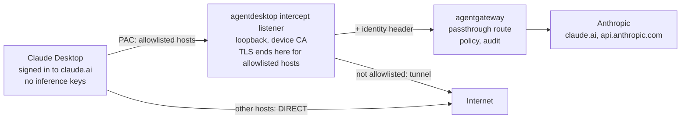

# Design: route first-party Claude Desktop through agentgateway

Status: draft for discussion. Issue: [#182](https://github.com/agentdesktop-dev/agentdesktop/issues/182).

Claude Desktop stays signed in to claude.ai. The agentdesktop daemon intercepts its Anthropic traffic on the device and sends it through agentgateway, so gateway policy applies without third-party mode.

## 1. Problem

Today, agentdesktop sends Claude Desktop through agentgateway in third-party inference mode. When `programs.claudeDesktop.useLlmGateway` is on, the Claude Desktop provider writes `inferenceProvider: "gateway"` and `inferenceGatewayBaseUrl` into the managed settings.

In third-party mode, Claude Desktop does not sign in to an Anthropic account. The claude.ai chat history, connectors and organization-managed settings (Claude Team and Enterprise) do not apply. If an organization uses these features, it cannot put agentgateway in the path without losing them.

## 2. Goals and non-goals

### Goals

- Claude Desktop stays signed in to claude.ai. The login, history, connectors and org settings of the user work as they do without a gateway.
- Claude Desktop sends its Anthropic traffic through agentgateway, so the gateway policies apply: authentication, guardrails and DLP, audit and telemetry.
- agentdesktop does not replace or change the claude.ai credentials of the user.
- The proxy decrypts only allowlisted Anthropic hosts. All other traffic is untouched.
- If the path through the gateway is down, traffic does not go around it. Fail closed is the default.

### Non-goals for this work

- Browser-based clients, for example chatgpt.com or Microsoft 365 Copilot on the web. The host allowlist is configuration, so it can extend to them later.
- Coexistence with an enterprise proxy that already inspects TLS. That needs its own test.
- Removal of third-party mode. It stays available for organizations that want it.

## 3. What the spike showed

A spike on macOS used mitmproxy as the local proxy, a PAC file on loopback, and a CA with full trust in the System keychain. The full results are in a comment on #182.

| Question | Result | Detail |
|---|---|---|
| Does Desktop follow the OS proxy and PAC? | Yes | The app, its renderer, the Code tab agent, the helpers and the updater. The Code tab agent gets its proxy from the app when the session starts. |
| Does it trust the OS trust store? Any pinning? | Yes, no pinning | 0 client TLS failures in about 3,100 requests. `NODE_EXTRA_CA_CERTS` was not necessary. With the CA untrusted, every claude.ai connection fails with `ERR_CERT_AUTHORITY_INVALID`. |
| Which protocols must the proxy carry? | Known | claude.ai uses HTTP/2 only, with SSE. The Code tab agent uses HTTP/1.1, SSE and a WebSocket. Remote Control uses WebSockets on `bridge.claudeusercontent.com`. |
| Where does user content travel? | Known | Desktop messages: JSON `events` on `claude.ai/v1/code/sessions/{id}/events`, with replies on an SSE `events/stream`. Connector calls: `{tool_name, arguments}`. Code tab: the Messages API. |
| Fail open or fail closed? | Closed | With a PAC that has no `DIRECT` fallback, messages fail while the proxy is down. Desktop reconnects about 6 seconds after the proxy returns, without a restart. |
| Sign-in (SSO) and history sync under interception | Not tested | These tests are necessary before the main use case is proven. |
| Where the model traffic for Cowork sessions goes | Open | The spike did not see it on any host. It possibly runs on the server, or the VM traffic goes around the host proxy. |
| App-scoped steering (`egressProxyPacUrl`) | Not tested | The result decides how steering works (see 4.2). |
| Upstream TLS errors after large uploads | Open | Two times, the upstream server sent `bad record mac` immediately after a 1.1 MB upload through mitmproxy. Retest with the TLS stack of the daemon. |

## 4. Design

### 4.1 Overview

The daemon runs an intercepting proxy on loopback. Steering sends only the Anthropic hosts of Claude to it. The proxy terminates TLS for those hosts with a device CA that the OS trusts. Then it sends each request to an agentgateway route. The request is unchanged, except for one added identity header. agentgateway applies its policy and forwards the request to Anthropic.



### 4.2 Steering

Steering decides which connections go to the listener. There are two possible mechanisms:

- **System PAC.** The daemon serves a PAC file on loopback. It sets the PAC as the automatic proxy configuration of the active network services. The spike showed that this works for every Claude process. It also steers each browser that uses the system proxy settings, so browser access to claude.ai also goes through the gateway. This can be wanted or not.
- **The managed key `egressProxyPacUrl` of Claude.** Claude Desktop reads this key from its managed preferences and uses the PAC only for itself. The daemon already writes the managed preferences of Claude. Anthropic documents that the app connects directly if it cannot download the pinned PAC, which is fail open. This is not tested yet in first-party mode.

Both mechanisms use the same PAC. The PAC sends allowlisted hosts to the listener with no `DIRECT` fallback, and all other hosts `DIRECT`. The listener core serves the PAC. The steering work item picks the mechanism after a test of the managed key (see section 10).

### 4.3 Intercept listener

- It listens on a loopback address only, and accepts HTTP `CONNECT`.
- For an allowlisted host, it terminates TLS with a leaf certificate for that SNI. The device CA issues the leaf, and the listener keeps it in a memory cache. Then the listener serves HTTP/2 and HTTP/1.1 (by ALPN) and forwards each request upstream.
- For all other hosts, it opens a plain TCP tunnel and does not decrypt. It must not refuse these connections. The Code tab agent gets one proxy address for all of its traffic, which includes GitHub and package registries.
- It streams in both directions without buffering: SSE responses, chunked bodies and WebSocket upgrades. Uploads of several MB are normal.
- It uses parts that `llm_proxy` already has where they fit: the tunnel relay, the credential cache and the 401 retry.
- It never logs request or response bodies, cookies, or `Authorization` values.

### 4.4 Device CA

- The daemon generates one CA per device with `rcgen`. It keeps the key in the secret store of the daemon, never on disk in clear text.
- The CA has an X.509 Name Constraints extension that permits only the allowlisted domains, for example `claude.ai`, `anthropic.com` and `claudeusercontent.com`. If the key leaks, it still cannot issue a certificate that a client accepts for a different site. When the allowlist grows past the constraints, the daemon issues a new CA.
- The trust install needs admin rights: the System keychain on macOS, and `LocalMachine\Root` on Windows. A daemon in system mode can do the install, or an MDM profile can deliver the certificate.
- Each process reads trust when it starts. After the daemon installs, rotates or removes a CA, Claude must restart. The daemon tells the user, or restarts Claude when this is safe.
- An admin can supply a CA instead of a generated one (see section 10).

### 4.5 Forwarding to agentgateway

- The listener sends each decrypted request to the configured gateway URL over HTTPS. It keeps the original method, path, query, body, `Cookie` and `Authorization` unchanged.
- It keeps the original host, so that the gateway can route by host. There are two options. In the first, `:authority` and `Host` stay `claude.ai`, while TLS goes to the address of the gateway. In the second, the gateway route has a path prefix for each host. The agentgateway maintainers pick one (see section 10).
- It adds one identity header that carries a gateway credential. agentgateway validates the header and removes it before the request goes upstream. The credential type is an open question (see 4.8).
- It uses HTTP/2 to the gateway where possible, because claude.ai traffic is HTTP/2 only and multiplexes many streams.

### 4.6 First-party mode for Claude Desktop

- A new setting on `programs.claudeDesktop` selects how the program uses the gateway: the current third-party inference (default), or intercept.
- In intercept mode, the provider writes no `inference*` keys, and removes the keys that it wrote before. It keeps the pass-through settings of the admin.
- If steering uses the managed key, the provider also writes `egressProxyPacUrl`.
- Validation rejects intercept mode when the daemon cannot run the listener.

### 4.7 Failure behavior

- The default is fail closed. The PAC has no `DIRECT` fallback for allowlisted hosts, so traffic waits for the listener. When the listener cannot reach the gateway, it returns an error. It does not connect upstream directly.
- Use the same meaning as the existing `llmGateway.whenProxyUnavailable` (`failClosed` or `failOpen`), so that admins see one policy name.
- Users see only "message failed". The daemon status and the desktop app must show the cause: listener down, gateway unreachable, or CA not trusted.

### 4.8 Daemon mode and identity

The trust install, the system PAC and the managed preferences of Claude all need system scope. The existing loopback proxy runs in user mode only, because it gives out the gateway credential of the user. This feature needs both scopes, so there are two possible shapes:

- **The system daemon owns everything.** There is one listener for each device. The identity header carries a device credential from the controller. This shape is simple, and on a single-user laptop the device maps to one user. It cannot tell two users of the same Mac apart.
- **Split.** The system daemon installs trust and steering. The daemon of each user runs its own listener and sends the gateway sign-in token of that user. This shape works only with per-user steering: the managed key of Claude for each user, not a system PAC.

This is an open question (see section 10). The listener core does not depend on it.

## 5. Configuration sketch

The names are proposals. The schema comes from `crates/core/src/config.rs`, as usual.

```yaml
daemon:
  intercept:
    listen: 127.0.0.1:18443        # loopback only
    hosts:                          # decrypted and sent to the gateway
      - claude.ai
      - api.anthropic.com
    steering: systemPac             # systemPac | claudeManagedKey
    ca:
      source: generated             # generated | file (admin-supplied cert and key)

llmGateway:
  url: https://gateway.example.com
  interceptUrl: https://gateway.example.com   # optional, like proxyUrl
  whenProxyUnavailable: failClosed            # existing setting, same meaning here

programs:
  claudeDesktop:
    gatewayMode: intercept          # inference (today, third-party) | intercept (first-party)
```

## 6. What agentgateway needs

This work is in the agentgateway repository and its example configurations. The daemon side assumes these items:

- A passthrough route for `claude.ai` and `api.anthropic.com`, with TLS to the real upstream. The route keeps the original `Cookie` and `Authorization`.
- HTTP/2 to the client and upstream, SSE without buffering, WebSocket upgrades, and long-lived streams.
- Validation of the identity header (a JWT) for attribution and policy, and removal of that header before upstream.
- Guardrail and DLP hooks on bodies that do not use the Messages API. These bodies are JSON `events` arrays on the session events endpoint, `{tool_name, arguments}` on connector tool calls, and multipart uploads.
- An audit log and telemetry, keyed to the identity from the header.

The agentdesktop repository gets an example under `examples/`, with a matching agentgateway configuration.

## 7. Security

- **Narrow decryption.** The proxy decrypts only allowlisted hosts. The name constraints of the CA also enforce this if the key leaks.
- **Key handling.** The CA key is in the secret store of the daemon. Rotation issues a new CA and removes the old trust.
- **Local access.** The listener is on loopback only. Any local process can connect to it, as with the existing loopback proxy. A local process can send requests to allowlisted hosts with the identity header of the device. Document this risk. Also consider a gateway-side binding of the identity to the claude.ai session.
- **No secrets in logs.** The daemon logs and telemetry contain no bodies, cookies or credentials.
- **Clean removal.** When an admin turns the feature off, the daemon removes the trust, the steering and the managed keys. It restarts Claude when this is safe.

## 8. Testing

- **Unit tests:** allowlist matching, CA generation with name constraints, the leaf cache, `CONNECT` handling for allowlisted and other hosts, and header handling.
- **Integration test:** a local TLS origin behind the listener. It covers HTTP/1.1, HTTP/2, SSE, a WebSocket and a multi-MB upload. The upload case retests the upstream TLS error from the spike on the TLS stack of the daemon.
- **Manual acceptance on macOS:** the checks from the spike again (Desktop through the listener, the untrusted-CA control, and proxy-down behavior). Add sign-in with SSO and history sync, which the spike did not cover.
- **Windows:** the same plan, after the steering and trust parts exist there.

## 9. Work items

Each work item can merge on its own. Only the steering and trust item changes system settings.

| Work item | Scope | Depends on |
|---|---|---|
| Listener core | The `daemon.intercept` configuration and schema. A name-constrained device CA in the secret store. A loopback `CONNECT` listener: TLS termination for allowlisted hosts, HTTP/2 and HTTP/1.1, unbuffered SSE, WebSocket upgrades, and a tunnel for other hosts. Forwarding to the configured gateway URL. A `/proxy.pac` endpoint. Unit and integration tests. It adds `tokio-rustls` and the HTTP/2 features of `hyper` and `hyper-rustls`. Steering stays manual for tests. | Nothing |
| Steering and trust on macOS | CA trust install and removal. The PAC on the active network services, or the managed key. Undo when the feature is off. Status in the daemon API and the desktop app. | Listener core; the steering and identity questions |
| First-party mode for Claude Desktop | `gatewayMode: intercept`, no inference keys, removal of old keys, and validation. | Listener core |
| Identity header | The credential source, the header name, and the removal contract, agreed with agentgateway. | Listener core; the identity and original-host questions |
| Windows | `LocalMachine\Root` trust and the system proxy settings. | Steering and trust |
| Example | An `examples/` setup with an agentgateway passthrough configuration and an identity check. | Identity header; the agentgateway work |

## 10. Open questions

| Question | Proposal |
|---|---|
| Decrypt on the device, or make agentgateway a forward proxy that decrypts? | **On the device.** The spike shows that Desktop accepts a device CA. Device-side interception keeps the gateway a normal reverse proxy. |
| Fail open or fail closed? | **Fail closed by default**, with `whenProxyUnavailable`. Make outages visible. |
| Who owns the CA? | **A generated CA for each device, with name constraints.** Also allow a CA from the admin. |
| Must browsers also go through the proxy? | Decide together with the steering mechanism. A system PAC steers browsers; the managed key does not. |
| Which daemon runs the listener, and whose identity does it send? | **The system daemon, with a device credential**, for the first version. Look at this again for shared Macs. |
| How does the gateway know the original host? | Keep `:authority`, or use a path prefix for each host. The agentgateway maintainers decide. |
| System PAC or the managed key of Claude for steering? | **Test first.** Test `egressProxyPacUrl` in first-party mode. Its documented fallback is fail open. |
