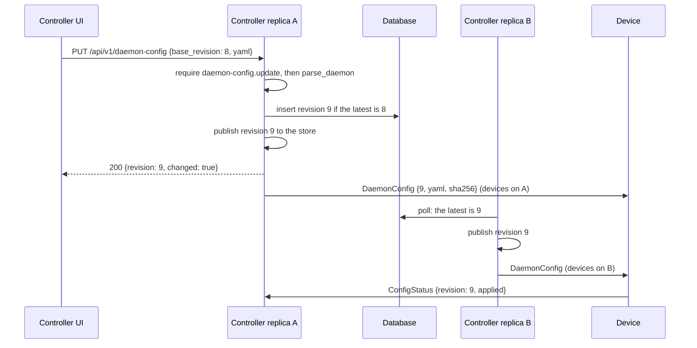

# Fleet configuration API

The fleet configuration is the daemon configuration the controller pushes to
enrolled devices. Admins can read it through the controller API and UI, but
they can change it only by editing the file named by `daemonConfig.path`.

This design adds a database mode. In that mode, admins change the
configuration through `PUT /api/v1/daemon-config` and the controller UI, and
each accepted change is recorded as a numbered revision with its author. File
mode stays as it is, read-only through the API, for deployments that keep the
configuration in Git.

This is the first part of two-admin approval (A6 in the control-plane
hardening plan). This part, A6.0, gives the controller a write path with
revisions and authors. A6.1 then makes a change on that path wait for a
second admin's approval.

The design ports Peter Jausovec's
[#57](https://github.com/agentdesktop-dev/agentdesktop/pull/57). #57 put a
writable database source and a read-only file source behind a
`FleetConfigurationSource` trait, with optimistic concurrency, revisions that
only increase, and a UI editor. It came before the pluggable management
authentication in
[#220](https://github.com/agentdesktop-dev/agentdesktop/pull/220) and is far
behind `main`, so this is a port, not a rebase.
[Changes from #57](#changes-from-57) lists where the design differs. Peter
Jausovec and Yuval Kohavi should review it.

## Current state

- `controller.yaml` sets `daemonConfig: { path, revision }`.
  [`daemon_config::watch`](../../crates/controller/src/daemon_config.rs) watches
  the file's parent directory, validates each change with
  `agentdesktop_core::config::parse_daemon`, and publishes valid content to
  `DaemonConfigStore`, a `tokio::sync::watch` channel. After an invalid edit,
  the store keeps the last good configuration and records `reload_error`.
- `FleetAgentService::connect`
  ([`service.rs`](../../crates/controller/src/service.rs)) subscribes to the
  store and sends each published `DaemonConfig { revision, yaml, sha256 }` to
  every connected device. The daemon checks the hash, parses and applies the
  configuration, and replies with `ConfigStatus { revision, state, error }`.
  The controller stores that reply in `device_config_status`.
- The revision is the fixed `daemonConfig.revision` value, which defaults
  to 1. A file edit publishes new content under the same revision. So when a
  device reports "revision 1 applied", the controller can't tell which content
  it applied, and a revert looks the same as the original. The Helm chart never
  sets `revision`, so every Helm install sends every configuration as
  revision 1.
- `GET /api/v1/daemon-config`
  ([`handlers.rs`](../../crates/controller/src/management/handlers.rs))
  returns the active configuration parsed to JSON and requires
  `daemon-config.read`. There is no write route.
- The UI Configuration view
  ([`ConfigurationView.tsx`](../../frontend/controller/src/views/ConfigurationView.tsx))
  is a form for part of the daemon configuration: gateway, telemetry, sandbox,
  program selection and programs. It generates YAML for the admin to copy into
  the file.
- The Helm chart puts `controller.yaml` and `daemon.yaml` in one ConfigMap, and
  the Deployment's `checksum/config` annotation hashes that ConfigMap. So a
  `helm upgrade` that changes only `daemonConfig` restarts the controller
  instead of using the hot reload.

## Goals

- Admins with permission change the fleet configuration from the UI or the
  API, with no file access and no controller restart.
- Every content change gets a new, higher revision in both modes.
- Each revision records who made it and when, and admins can view and restore
  old revisions.
- Deployments that keep the configuration in Git keep a read-only controller.
- A6.1 can add an approval step without changing the API shape or the
  revision table.

## Non-goals

- Two-admin approval, which is A6.1.
- Editing `controller.yaml` (listeners, OIDC, TLS, admin access). Those
  settings still need a restart.
- Per-device or per-group configuration, and staged or canary rollouts. A save
  goes to every connected device.
- Configuration signing and daemon-side rollback protection. See
  [Relation to the hardening plan](#relation-to-the-hardening-plan).

## Sources

The configured source decides who can write new revisions. Both sources write
to the revision table described under [Revisions](#revisions).

| | File | Database |
| --- | --- | --- |
| `controller.yaml` | `daemonConfig: { path, revision }` (unchanged) | `daemonConfig: { database: { seedPath } }` |
| Writes revisions | the file watcher | `PUT /api/v1/daemon-config` |
| API and UI | read-only; `PUT` returns 405 | read and write |
| Use it when | the configuration is in Git and changes go through PR review | there is no GitOps pipeline, e.g. a VM install |

If `daemonConfig` is omitted, there is still no managed configuration.

`path` and `database` are mutually exclusive. Setting both, or neither, fails
at startup. #57 used an untagged serde enum here, which gives vague errors
under `deny_unknown_fields`. A struct with optional fields and a check in
`parse_controller` gives a precise message instead. `make generate-schema`
picks up the new shape.

### Database mode startup

1. If the revision table has rows, the latest row is the active configuration
   and `seedPath` is ignored.
2. If the table is empty and `seedPath` is set, the controller validates the
   seed file and stores it as the first revision, with author `seed`. An
   invalid seed fails startup.
3. If the table is empty and there is no seed, there is no active
   configuration and nothing is pushed until the first save. In this case #57
   seeded `programs: {}`. But pushing an empty configuration would make every
   connected daemon stop managing its programs, so this design pushes nothing.

### Switching modes

Both modes write the same table, so switching is a `controller.yaml` change
and a restart.

- **File to database.** The latest file revision stays active, so devices
  receive nothing new, and the next save follows on from that revision. Remove
  the file from the Git repository, or mark it as no longer used, so nobody
  edits a file the controller no longer reads.
- **Database to file.** At startup, if the file's content differs from the
  latest revision, the file becomes a new revision and is pushed. Edits made
  in the UI are lost from the active configuration unless someone copies them
  into the file first. Export the active YAML from `GET` and commit it before
  switching. History keeps the old revisions.

## Revisions

A new, append-only table holds every configuration the controller has
published:

```sql
CREATE TABLE daemon_config_revisions (
    revision BIGINT PRIMARY KEY CHECK (revision > 0),
    yaml TEXT NOT NULL,
    sha256 TEXT NOT NULL,       -- hex, over the exact YAML bytes
    created_at BIGINT NOT NULL,
    author_kind TEXT NOT NULL,  -- local | human | service | file | seed
    author_issuer TEXT NOT NULL,
    author_subject TEXT NOT NULL,
    author_client_id TEXT,      -- service credentials only
    author_display TEXT,        -- e.g. the email claim at the time of the change
    message TEXT NOT NULL DEFAULT ''
);
```

It is added in a new migration. The latest row is the active configuration.

- **Revisions only go up.** A save inserts `base_revision + 1`, and only if
  `base_revision` is still the latest revision:

  ```sql
  INSERT INTO daemon_config_revisions (revision, yaml, sha256, ...)
  SELECT $next, $yaml, $sha256, ...
  WHERE COALESCE((SELECT MAX(revision) FROM daemon_config_revisions), 0) = $base
  ```

  If no row is inserted, someone else saved first. Under Postgres read
  committed, two concurrent saves from the same base can both pass the
  `WHERE`, but the primary key then rejects the second insert. The handler
  returns 409 in both cases. This works the same on SQLite and on Postgres
  through the `Any` driver, with no advisory locks.
- **Unchanged saves do nothing.** If the YAML bytes equal the latest
  revision's bytes, nothing is inserted or pushed, and the response returns the
  current revision.
- **Content is stored byte for byte**, comments included. The `sha256` sent to
  devices is over these exact bytes, which is what the daemon already checks.
- **Restoring an old revision** means saving its YAML again, which creates a
  new, higher revision. History is never rewritten.

`DaemonConfigStore::publish` only moves forward, as in #57. It ignores a
revision lower than the active one, and it refuses to reuse a revision number
for different content. In both cases it logs the problem and records an error.

### File mode revisions

The watcher keeps validating and publishing as it does today, but it now takes
the revision from the table.

- When a replica sees its file change, or reads the file at startup, and the
  content differs from the latest revision, it inserts a new revision with the
  same conditional insert. The author kind is `file` and the subject is the
  file path. The next revision is the larger of `latest + 1` and
  `daemonConfig.revision`. If another replica inserted first, this replica
  re-reads the latest row and adopts it when the content matches.
- A replica inserts only when it saw its own file change, not just because its
  file differs from the latest row. Otherwise, a replica whose ConfigMap
  projection lags behind would write the old content back as a newer revision.
- `daemonConfig.revision` sets the starting revision when the table is empty.
  So a fleet whose devices know the configuration as revision 7 keeps
  revision 7 for the same content, and the next edit becomes revision 8.
- If the insert fails, for example because the database is unreachable, the
  previous revision stays active. The replica records `reload_error` and
  retries on its next poll.

This removes the fixed revision for GitOps users, and they don't have to
change their files. Device status now shows exactly which content each device
applied.

If the database is lost, revisions start again from `daemonConfig.revision`.
Daemons accept any revision today, so devices keep working. To keep the
numbers increasing, raise `daemonConfig.revision` above the last revision
devices saw.

### Replicas

The store lives in each controller process. With more than one replica
(Postgres only), a save on one replica must reach devices connected to the
others. So each replica polls `SELECT MAX(revision)` every few seconds. When
the result is higher than its active revision, the replica loads that row and
publishes it, as #57 did. Devices connected to other replicas get the change
one poll interval later. Postgres `LISTEN/NOTIFY` would remove that delay, but
it needs a dedicated Postgres connection outside the `Any` pool, so it can wait
until the delay matters.

`GET /api/v1/daemon-config` reads the table, not the store. A read right after
a save on another replica therefore already sees the new revision.

## API

All routes go through the existing management router. That gives them the
cross-origin check on writes, `Cache-Control: no-store`, the request timeout
and the `admin action` log line. Field names are snake_case, like the rest of
the management API.

### `GET /api/v1/daemon-config`

This route requires `daemon-config.read`. The response keeps today's `config`
field and adds new fields:

```json
{
  "config": { "programs": { "claudeCode": {} } },
  "yaml": "programs:\n  claudeCode: {}\n",
  "revision": 8,
  "sha256": "9f2c…",
  "source": "database",
  "writable": true,
  "created_at": 1762790400,
  "author": {
    "kind": "human",
    "issuer": "https://idp.example.com",
    "subject": "…",
    "display": "admin@example.com"
  },
  "message": "Enable the sandbox",
  "reload_error": null
}
```

- `source` is `file`, `database`, or `null` when `daemonConfig` is not set.
- `writable` is true only in database mode. The UI shows Save only when
  `writable` is true and the session has `daemon-config.update`.
- `reload_error` holds the last file reload failure in file mode, while the
  last good revision stays active. In database mode it is `null`.
- When there is no active configuration, `config`, `yaml` and `revision` are
  `null`.

### `PUT /api/v1/daemon-config`

This route requires `daemon-config.update`. Request body:

```json
{
  "base_revision": 8,
  "yaml": "programs:\n  claudeCode: {}\n",
  "message": "Enable the sandbox"
}
```

`base_revision` is the revision the edit started from, or 0 when there is no
active configuration. `message` is optional and appears in history.

| Status | `error` | When |
| --- | --- | --- |
| 200 | | Saved. The body is the `GET` response for the new revision, or for the current revision when the YAML was unchanged, plus `"changed": true` or `false`. |
| 400 | `invalid_request` | The JSON is malformed or a field is missing. Axum's default `Json` rejection returns 422 for some of these, so the handler maps them to 400 and keeps 422 for one meaning. |
| 401, 403 | set by the provider | Signed out, not permitted, or `reauthentication_required` when the provider wants a recent sign-in before a mutation. |
| 405 | `read_only_source` | The controller is in file mode or has no `daemonConfig`. The response sets `Allow: GET`. This is checked after authorization. |
| 409 | `revision_conflict` | `base_revision` is not the latest revision. The body includes the latest `revision`, so the UI can show what changed. |
| 413 | `too_large` | The YAML is over the size limit. |
| 422 | `invalid_daemon_config` | The YAML is invalid or `parse_daemon` rejects it. `detail` holds the parser message. |

The 405 for a read-only source and the split between 409 and 422 come from the
design in #57.

### `GET /api/v1/daemon-config/revisions` and `GET /api/v1/daemon-config/revisions/{revision}`

The list route returns revision metadata, newest first: revision, sha256,
created_at, author and message. It pages with `?before=<revision>&limit=<n>`.
The single-revision route also returns the `yaml`.

The list requires `daemon-config.list`. A single revision requires
`daemon-config.read`, with the revision number as the resource. Both are reads
in `OPERATIONS`, so anyone with `admin.read` can use them, just as they can
already read the active configuration. Both routes work in both modes.

## Validation

The controller validates with the same function the file watcher and the
daemon use: `agentdesktop_core::config::parse_daemon`. It parses strictly,
rejects unknown fields, rejects `daemon:` startup settings, and requires an
HTTPS controller address. So any configuration the controller accepts, a
daemon of the same version can parse.

A save also has a size limit: 256 KiB of YAML, taken from #57. The route has
its own body limit, sized for 256 KiB of YAML after JSON escaping, and the
handler checks the YAML string itself as well. The limit is far below the
fleet gRPC message size.

Version skew: a newer controller can accept a field that an older daemon
rejects. The `programSelection` docs already warn about this. The controller
doesn't block such a save. A daemon that can't parse a pushed configuration
keeps its current one and reports `FAILED` with the parse error, which shows on
the device page and in the overview's failure count. Before saving, the UI
warns if any device reports an `agent_version` older than the controller's own
version.

The editor can use `schema/daemon-config.json` for completion and inline
hints, but the server's validation is what counts.

## Pushing to devices

When a save inserts a revision, the replica that handled it publishes the
revision to its `DaemonConfigStore`, the same call the file watcher makes. The
rest of the path is unchanged:

1. Each device's `connect` stream gets the new `DaemonConfig` from its
   subscription.
2. The device applies it and reports `ConfigStatus` with the new revision.
3. The controller records the result in `device_config_status`.

`GetLlmGatewayCredential` also reads the store, so a change to `llmGateway`
affects credential issuance as soon as it is published.

The watch channel holds only the latest value. A device whose stream is busy
skips the revisions in between and gets the newest one. A device that is
offline gets the active revision when it reconnects, as today.



The UI can track rollout from the device list. Each device's
`config_revision` and `config_state` already come from `device_config_status`.

## Permissions

[`OPERATIONS`](../../crates/controller/src/management/auth/authorization.rs)
gets two new entries:

```rust
(Verb::List, DAEMON_CONFIG),
(Verb::Update, DAEMON_CONFIG),
```

`(Verb::Read, DAEMON_CONFIG)` already exists. It now also covers reading a
single revision, with `resource: Some(revision)`.

- The first thing the `PUT` handler does is call `Context::require` with
  `Verb::Update`, `DAEMON_CONFIG` and no resource. That happens before
  validation and before any database access.
- `covered_by_admin_read` excludes mutations, so `admin.read` alone doesn't
  grant `daemon-config.update`. It does cover the new list read.
- The local provider grants every operation. So the loopback operator can save,
  and `/auth/session` lists `daemon-config.update`, taken from
  `permission_names()`, for the UI.
- Authenticated providers decide who gets `daemon-config.update`. Under the
  #220 contract, a provider can already require a recent sign-in for
  mutations. The UI handles `reauthentication_required` here the same way it
  does for device delete.

## Audit

Each revision row records its author from the #220 `Principal` that passed
`Context::require`:

- `kind` (`local`, `human` or `service`), `issuer` and `subject` from the
  principal, plus `client_id` for service credentials.
- `display`: the principal's `email`, `preferred_username` or `name` claim at
  the time of the change, if it has one. This keeps history readable even if
  the IdP account changes later. Only that one claim is stored, not the whole
  claim snapshot.
- File and seed revisions record kind `file` or `seed`, with the file path as
  the subject.

Local mode has only one identity (`local` / `localhost`). So history can say
a change came from the loopback operator, but not which person made it.

The existing `admin action` log line already records the method, path,
principal and status. The handler adds a `daemon configuration saved` line
with the old and new revision and the new hash, so log-based audit trails get
the revision numbers. The table is the audit record you can query, and the
history API and the UI read from it.

History contains each revision's full YAML. Anyone with `daemon-config.read`
can see it, just as they can already see the active configuration. The daemon
configuration should not contain secrets, and this design doesn't change that.

## UI

When `writable` is true and the session has `daemon-config.update`, the
Configuration view becomes an editor. Otherwise it stays read-only.

- **YAML tab.** A text editor that holds the exact YAML that will be saved. It
  loads `yaml` from `GET`, not the parsed `config`, so comments and formatting
  are kept.
- **Builder tab.** Today's form, changed to edit the YAML document in place
  with the `yaml` package's `Document` API, as #57 did, instead of rebuilding
  the YAML from form state. Fields the form doesn't cover, such as
  `inventoryInterval`, and comments are left as they are. Today's generator
  drops them, which is acceptable when the admin copies and pastes the output
  but not when the controller saves it.
- **Save.** Save opens a review step that shows:
  - a line diff against the base revision;
  - an optional message field;
  - how many connected devices will receive the change right away.

  Confirming the review sends the `PUT`.
- **Errors.**
  - On 422, the editor shows the parser message next to the YAML.
  - On 409, it shows who saved which revision, with a diff between that
    revision and the draft. The user can reload, which discards the draft, or
    keep the draft and save it on top of the new revision.
  - On 403 `reauthentication_required`, it offers a fresh sign-in, as device
    delete does.
- **After saving.** The view shows the new revision and rollout counts: how
  many devices applied it, how many failed, and how many haven't reported.
- **History.** A list of revisions with author, time and message. Selecting a
  revision shows its YAML and a diff against the one before it. "Restore"
  loads it into the editor as a draft, which the user saves like any other
  change.
- **Unsaved changes.** Leaving the page with unsaved changes asks for
  confirmation.
- **File mode.** A banner says the configuration comes from a file and must be
  changed there. The builder keeps its Copy button for producing YAML to
  commit. History is available in both modes.

## Helm

- A new value, `daemonConfigSource: file | database`, defaults to `file`. With
  `database`, the chart writes `daemonConfig: { database: { seedPath } }` into
  `controller.yaml` and mounts the `daemonConfig` values as the seed file.
- `daemon.yaml` moves to its own ConfigMap, outside the `checksum/config`
  annotation. In file mode, a `helm upgrade` that changes only `daemonConfig`
  then reaches devices through the watcher, without restarting the controller.
  In database mode, a changed seed doesn't restart the pod; once the table has
  rows, the controller ignores the seed anyway.
- `NOTES.txt` and `deploy/README.md` say that in database mode the
  `daemonConfig` values are only a seed: changing them after the first start
  has no effect.
- With `existingConfigSecret`, the Secret's `controller.yaml` selects the mode.
  The chart fails if `daemonConfigSource: database` is also set, as #57's chart
  did.

## Relation to the hardening plan

- **C6 (keep the admin UI read-only for configuration and make changes
  through GitOps PRs with two approvers).** File mode is that model. It
  doesn't change and stays the Helm default. Database mode is opt-in, for
  installs without a Git pipeline. Until A6.1 lands, database mode lets one
  admin change the fleet configuration alone. A6.1 closes that gap by moving
  the second approver into the controller. Deployments that need two
  approvers before then should stay on file mode.
- **C2 (sign configuration in CI so the controller never holds the signing
  key).** This fits file mode: CI signs the file, and the controller stores and
  forwards a detached signature it couldn't produce itself. Database mode can't
  meet C2 as written, because the content is created inside the controller and
  nothing outside it signs. When C2 is designed, the choice is either for
  A6.1's approvers to sign with keys the controller doesn't hold (for example,
  in the browser), or for C2 to apply to file mode only. The revision table
  has room for a signature column either way. This design doesn't choose.
- **C3 (revisions).** The revision table gives every content change a new,
  higher revision in both modes. Daemon-side enforcement, meaning rejecting a
  push whose revision is lower than the last one applied, isn't part of this
  design. It matters most once configurations are signed, because without it
  an old signed revision could be replayed.

## What A6.1 needs from this

A6.1 makes destructive or fleet-wide actions wait for a second admin's
approval. Every fleet configuration change goes to every device, so A6.1 will
probably require approval for every database-mode save. A6.0 leaves these
hooks for it:

- **One apply function.** The `PUT` handler validates the YAML, then calls a
  single function that does the conditional insert and the publish. A6.1 calls
  that function when a change is approved, not when it is submitted, with the
  same `base_revision` check. If another change was applied in between, the
  approved change is stale and has to be rebased; it is never applied over the
  newer revision.
- **Change records.** A6.1 adds a table of proposed changes with these fields:
  - id, `base_revision`, `yaml`, `sha256` and proposer;
  - state: pending, approved, rejected, applied, stale or expired;
  - each approval's principal and time;
  - the revision it was applied as.

  A6.0 doesn't create this table. A6.1 also adds a nullable `change_id` column
  to the revision table, so each revision links back to its proposal and
  approvers.
- **Status codes.** When approval is required, `PUT` returns 202 with the
  change id instead of 200 with a revision. API clients must treat 202 as
  "submitted, not applied". The A6.0 UI handles only 200, and A6.1 updates it.
- **Identity.** To stop admins approving their own changes, approval needs a
  stable principal identity, which is the issuer plus the subject. #220
  provides that in authenticated mode. Local mode has only one identity, so
  approval can't be enforced there.
- **Permissions.** `Verb` has no approve verb. A6.1 adds one that counts as a
  mutation, or adds a separate resource class for change records. After that,
  `daemon-config.update` means "propose a change".

## Changes from #57

Kept from #57:

- the split between a read-only file source and a writable database source;
- optimistic concurrency;
- 405 for a read-only source, 409 for a conflict and 422 for an invalid
  document;
- a store that only moves forward, and saves that do nothing when the YAML is
  unchanged;
- the size limit;
- polling between replicas;
- a form that edits the YAML document in place.

Changed:

- A revision history table replaces the single row, so the controller can show
  authors and restore old revisions.
- File mode records revisions too. That removes the fixed revision for GitOps
  users and makes switching modes a configuration change with no re-seeding.
  `seedRevision` goes away, and `daemonConfig.revision` sets the starting
  revision instead.
- An empty database with no seed pushes nothing, instead of `programs: {}`.
- The route stays `/api/v1/daemon-config`. The precondition is the numeric
  `base_revision`, not the string `version`, which #57 needed while it used a
  ConfigMap `resourceVersion`.
- Authorization goes through #220's `OPERATIONS` and `Context::require`, and
  each revision records its author.
- The ConfigMap backend, which #57 replaced with Postgres during review, is
  not carried over.

## Tests

Controller (Rust; unit tests use SQLite):

- **Concurrency.** Two concurrent saves from the same base give one 200 and one
  409. A save from a stale base gets 409. A rejected save leaves the latest
  revision unchanged.
- **Unchanged save.** It returns `changed: false`, inserts nothing and
  publishes nothing.
- **Rejected input.** Invalid YAML returns 422 with the parser message, and
  oversized YAML returns 413. Neither changes the table or the store.
- **File mode.**
  - `PUT` returns 405, and `GET` reports `writable: false`.
  - A file edit inserts a new revision, and a revert inserts another.
  - A restart with an unchanged file inserts nothing.
  - With an empty table, the first revision is `daemonConfig.revision`.
  - A replica with a stale file doesn't write it back (two stores over one
    database).
- **Switching modes.** File to database keeps the active revision and pushes
  nothing. Database to file with different content inserts a revision.
- **Database mode startup.**
  - The seed is stored once and ignored after that.
  - Without a seed, there is no active configuration.
  - An invalid seed fails startup.
- **Store.** Stale and reused revisions are rejected, as in #57's test.
- **Replicas.** A save through one store reaches a second store on the same
  database at the next poll (with paused Tokio time).
- **Push.** After a save, a device stream receives the new `DaemonConfig` with
  the new revision and a matching hash.
- **Authorization.**
  - `management_routes_check_precise_operations` and
    `admin_read_covers_every_management_read_but_no_mutation` cover the new
    routes.
  - `admin.read` alone gets 403 on `PUT`.
  - Local mode can save.
  - The HTTP policy rejects a cross-site `PUT`.
- **Audit.** Revisions saved by local, human and service principals record the
  right author fields.

Postgres: the conditional insert relies on the primary key under read
committed, and the controller's unit tests run only on SQLite. So one Postgres
test of concurrent saves is needed. It can run where Docker is available, like
the agent's integration tests.

Frontend (Storybook interaction and accessibility tests):

- one story for each editor state: read-only, editing, saving, conflict,
  invalid, reauthentication, history and file mode;
- a test that changing a field in the builder leaves unknown fields and
  comments intact.

Helm: `helm template` renders both modes, and changing only `daemonConfig`
leaves the checksum annotation unchanged.

## Work items

1. **Revision table and file-mode revisions.** The new migration, the
   conditional insert, a `publish` that only moves forward, the file watcher
   writing revisions, `daemonConfig.revision` as the starting revision, and
   the new `GET` response fields. No write API. This item fixes the fixed
   revision by itself.
2. **Database mode and `PUT`.** `daemonConfig.database` in `controller.yaml`
   and the generated schema, startup seeding, the `PUT` handler and its errors,
   `daemon-config.update` in `OPERATIONS`, author recording, and polling
   between replicas. Depends on 1.
3. **Revision history API.** The two `revisions` routes and
   `daemon-config.list`. Depends on 1.
4. **UI editor.** The YAML tab, the in-place builder, review and save, conflict
   and error handling, rollout counts, and history and restore. Depends on 2
   and 3.
5. **Helm and docs.** `daemonConfigSource`, `deploy/README.md` and the
   examples, which depend on 2. Moving `daemon.yaml` out of the checksummed
   ConfigMap doesn't depend on anything and can land first.

## Open questions

1. **Single-admin writes before A6.1.** Should database mode ship before A6.1
   or wait for approval? Shipping first gets a UI to installs without
   Kubernetes sooner. The cost is that until A6.1 lands, one admin can change
   the whole fleet.
2. **C2 in database mode.** Does C2 apply only to file mode, or should A6.1's
   approvers sign? The answer decides whether A6.0's revision table needs a
   signature column now.
3. **Local mode after A6.1.** With only one identity, should local mode keep
   saving without approval, as a single trusted operator, or should A6.1 allow
   database-mode writes only in authenticated mode?
4. **Route name.** Keep `/api/v1/daemon-config`, as this design does, or adopt
   #57's `/api/v1/fleet-configuration` and rename the permission class to
   match?
5. **Version skew.** Is a warning based on `agent_version` enough? Or should
   the controller know each field's minimum daemon version and block a save
   that some enrolled devices can't parse?
6. **History retention.** Keep every revision, since configurations are small
   and humans make the saves? Or prune by count or age? Audit argues for
   keeping everything.
7. **Service credentials.** Should providers be able to grant
   `daemon-config.update` to service principals, so changes can be scripted,
   or only to people?
