# Device identity and enrollment

This document describes how a workstation becomes a trusted, user-bound
device in controller-managed mode, and how that identity is used afterwards.
It covers the interactions between:

- **User**: the person signing in on the workstation.
- **Browser**: the user's browser, usually on the same workstation.
- **Daemon**: the Agentdesktop daemon running on the workstation
  (`crates/agent`).
- **AI tool**: a managed developer tool (Claude Code, Codex, and so on) that
  asks the daemon for gateway credentials.
- **Controller**: the fleet controller (`crates/controller`), reached over
  the gRPC `FleetAgent` service defined in
  [`fleet.proto`](../crates/proto/proto/fleet.proto).
- **IdP**: the organization's OpenID Connect provider.

To run both enrollment flows locally with the desktop app and the headless
daemon, see the [enrollment lab](../examples/enrollment/README.md).

## Identity model

A device's identity has two parts, and the controller requires both on every
protected call:

| Part | Held by the daemon | Proves |
| --- | --- | --- |
| Device certificate | Private key generated on the device, certificate signed by the controller's device CA. Used as the TLS client certificate (mTLS). | Which device is calling. The device ID is the UUID in the certificate's DNS SAN `DEVICE_ID.device.agentdesktop.invalid`. |
| OIDC access token | Access and refresh tokens obtained directly from the IdP. Sent as `authorization: Bearer ...` gRPC metadata. | Which user is calling. |

At enrollment the controller records the IdP issuer and subject (`iss`,
`sub`) of the user who enrolled the device. Afterwards, a call is accepted only
when the access token's subject, as reported by the IdP's UserInfo endpoint,
matches the subject recorded for the device named in the certificate. A device
certificate alone, or a valid user token presented with another user's
device certificate, is rejected.

Key properties:

- The device private key never leaves the workstation. The daemon sends only a
  certificate signing request (CSR).
- The daemon is an OIDC public client. It talks to the IdP's token endpoint
  directly. The controller never sees the PKCE verifier or the authorization
  code, and never holds the user's refresh token.
- The controller drives the parts of the protocol that bind the result to an
  enrollment: it generates `state` and `nonce`, builds the authorization URL,
  and validates the ID token it is given.

## Sequence

```mermaid
sequenceDiagram
    actor User
    box Workstation
        participant App as Desktop app
        participant Browser
        participant Daemon
        participant Tool as AI tool
    end
    participant Controller
    participant IdP as OIDC provider

    Note over Daemon: Startup. Load identity.json and secrets from the OS secret store. If none exist, start enrolling at once, without waiting for a user.

    rect rgba(128, 35, 195, 0.08)
    Note over User,IdP: Enrollment
    Daemon->>Daemon: Generate device key pair and CSR
    alt Browser flow (default)
        Daemon->>Daemon: Generate PKCE verifier and S256 challenge
        Daemon->>Controller: BeginEnrollment(hostname, code_challenge) over server-auth TLS
        Controller->>Controller: Create enrollment_id, state, nonce. Store pending enrollment (10 min)
        Controller-->>Daemon: enrollment_id, authorization_url, state, redirect_uri, token_endpoint, client_id
        Daemon->>Daemon: Listen on loopback redirect_uri (default 127.0.0.1:51327)
        Daemon->>Daemon: Publish authorization_url on GET /v1/enrollment and wait up to 10 min
        alt Daemon runs as a system service (normal install)
            Note over Daemon: Cannot open a browser. It runs outside any user session.
            User->>App: Sign in
            App->>Daemon: GET /v1/enrollment
            Daemon-->>App: authorization_url
            App->>Browser: Open authorization_url
        else Daemon runs in the user's session (sudo, user mode, development)
            Daemon->>Browser: Open the local sign-in page
            User->>Browser: Continue to sign in
        end
        Browser->>IdP: Authorization request (scope openid profile email offline_access, state, nonce, PKCE challenge)
        User->>IdP: Authenticate
        IdP-->>Browser: Redirect to loopback callback with code and state
        Browser->>Daemon: GET /callback?code=...&state=...
        Daemon->>Daemon: Check state matches
        Daemon->>IdP: Token request (authorization_code, code_verifier, client_id)
        IdP-->>Daemon: access_token, id_token, refresh_token
    else Device authorization flow (deviceAuthorization true)
        Daemon->>Controller: BeginEnrollment(hostname, device_authorization)
        Controller->>IdP: Device authorization request (client_id, scope)
        IdP-->>Controller: device_code, user_code, verification_uri, interval, expires_in
        Controller->>Controller: Store pending enrollment (no nonce)
        Controller-->>Daemon: enrollment_id, device_code, user_code, verification_uri, token_endpoint, client_id
        Daemon-->>User: Show verification URL and user code (app, CLI, logs)
        loop Every interval until approved or expired
            Daemon->>IdP: Token request (device_code grant)
            IdP-->>Daemon: authorization_pending or slow_down
        end
        User->>IdP: Open verification URL on any device, enter code, authenticate
        Daemon->>IdP: Token request (device_code grant)
        IdP-->>Daemon: access_token, id_token, refresh_token
    end
    Daemon->>Controller: CompleteEnrollment(enrollment_id, CSR, id_token) with Bearer access_token
    Controller->>Controller: Consume pending enrollment (single use, not expired)
    Controller->>IdP: Fetch JWKS if the ID token key ID is unknown
    Controller->>Controller: Verify ID token signature, iss, aud, exp, sub, and nonce
    Controller->>IdP: UserInfo with access_token
    IdP-->>Controller: sub
    Controller->>Controller: Require UserInfo sub equal to ID token sub
    Controller->>Controller: New device_id. Sign CSR with device CA (30 days, client auth)
    Controller->>Controller: Store device with hostname, issuer, subject, IdP claims
    Controller-->>Daemon: device_id, certificate chain, expiry
    Daemon->>Daemon: Save certificate to identity.json. Save private key and tokens to the secret store
    end

    rect rgba(36, 120, 200, 0.08)
    Note over Daemon,IdP: Each controller session
    opt Access token expires within 2 min
        Daemon->>IdP: Token request (refresh_token grant)
        IdP-->>Daemon: New access_token (and rotated refresh_token)
    end
    opt Device certificate expires within 24 h
        Daemon->>Controller: RenewDeviceCertificate(CSR from the same key) over mTLS with Bearer token
        Controller->>IdP: UserInfo with access_token
        Controller-->>Daemon: New certificate (30 days)
    end
    Daemon->>Controller: Connect stream over mTLS with Bearer access_token
    Controller->>Controller: Read device_id from client certificate SAN
    Controller->>IdP: UserInfo with access_token
    IdP-->>Controller: sub
    Controller->>Controller: Require issuer and sub equal to the enrolled user
    Controller-->>Daemon: DaemonConfig (current revision)
    Daemon->>Controller: Hello (device_id must match the certificate)
    Daemon->>Controller: Inventory
    Daemon->>Daemon: Apply configuration to managed tools
    Daemon->>Controller: ConfigStatus
    par Stream traffic
        loop Every heartbeat interval
            Daemon->>Controller: Heartbeat
        end
    and Controller revalidation
        loop Every 5 min
            Controller->>IdP: UserInfo with the stream's access_token
            alt Token rejected or subject changed
                Controller-->>Daemon: Close stream (Unauthenticated or PermissionDenied)
            else IdP unavailable
                Controller->>Controller: Keep stream open
            end
        end
    and Policy updates
        Controller-->>Daemon: DaemonConfig (new revision)
        Daemon->>Controller: ConfigStatus
    end
    Daemon->>Daemon: 60 s before access token expiry, close stream and start a new session
    end

    rect rgba(30, 150, 90, 0.08)
    Note over Tool,Controller: Gateway credential (llmGateway.authentication controllerJwt)
    Tool->>Daemon: Credential helper or LLM proxy asks for a credential for client_id
    alt Cached credential (at most 60 s, not within 30 s of expiry)
        Daemon-->>Tool: Cached JWT
    else
        Daemon->>Daemon: Refresh OIDC access token if needed
        Daemon->>Controller: GetLlmGatewayCredential(client_id) over mTLS with Bearer token
        Controller->>IdP: UserInfo with access_token
        Controller->>Controller: Check client_id is in allowedClientIds
        Controller->>Controller: Sign JWT (sub user, act.sub device_id, client_id, aud, email, IdP claims)
        Controller-->>Daemon: JWT and expiry (default lifetime 5 min)
        Daemon-->>Tool: JWT
    end
    Note over Tool,Controller: The tool sends the JWT to the LLM gateway, which verifies it with the controller JWKS at /.well-known/jwks.json
    end

    rect rgba(200, 80, 40, 0.08)
    Note over User,App: Logout
    User->>App: Log out
    App->>Daemon: POST /v1/logout
    Daemon->>Daemon: Delete identity.json, device key, and OIDC tokens. Stop enforcing the controller configuration
    Daemon->>Daemon: Return to enrollment
    end
```

## Enrollment

The daemon enrolls when it starts without a stored identity, or after it has
discarded one (see [Failure handling](#failure-handling)). It starts at once,
without waiting for a user to ask: an attempt that nobody completes times out
after 10 minutes, and the daemon starts a new one after a retry delay of up to
60 seconds, with a new URL each time. While enrollment is
in progress, the daemon publishes its state on the local API at
`GET /v1/enrollment` (`notConfigured`, `starting`, `awaitingAuthentication`,
`enrolling`, `enrolled`, `failed`), together with the sign-in URL and, for
device authorization, the user code. The desktop app and
`agentdesktop enrollment` read this endpoint.

### Browser flow

The default flow is the OAuth 2.0 authorization code grant with PKCE for a
native app (RFC 8252):

1. The daemon generates the device key pair, a CSR for it, and a PKCE
   verifier and challenge.
2. `BeginEnrollment` sends the hostname and PKCE challenge. The daemon has no
   client certificate yet, so this call uses server-authenticated TLS only.
   The controller generates a random `enrollment_id`, `state`, and `nonce`,
   and keeps a pending enrollment (hostname and nonce) for 10 minutes. At most
   1024 enrollments can be pending at once.
3. The controller returns an authorization URL built from the IdP's discovery
   document, requesting `openid profile email offline_access`, plus the
   values the daemon needs to finish the exchange itself: `state`,
   `redirect_uri`, `token_endpoint`, and `client_id`.
4. The daemon serves a small HTTP server on the loopback `redirect_uri`
   (default `http://127.0.0.1:51327/callback`) and publishes the
   authorization URL on `/v1/enrollment`. How the browser gets there depends
   on how the daemon runs:
   - **As a system service** (the normal install: LaunchDaemon, Windows
     service, systemd), the daemon runs outside any user session and cannot
     open a browser. Its attempt to do so fails and is only logged. The user
     clicks sign-in in the desktop app, which reads the URL from
     `/v1/enrollment` and opens it in the user's browser. The browser goes
     straight to the IdP.
   - **In the user's session** (`sudo` from a terminal, `--user` mode,
     development), the daemon opens the browser on its own landing page, and
     **Continue to sign in** redirects to the IdP.

   `agentdesktop enrollment` prints the same URL.
5. After the user authenticates, the IdP redirects to the loopback callback.
   The daemon rejects the callback unless `state` matches, then exchanges the
   code and PKCE verifier at the IdP token endpoint. The callback times out
   after 10 minutes.
6. `CompleteEnrollment` sends the `enrollment_id`, the CSR, and the ID token,
   with the access token as a bearer credential.

### Device authorization flow

For hosts without a local browser, set `deviceAuthorization: true` in the
daemon's controller connection. The IdP must advertise a
`device_authorization_endpoint`. This follows RFC 8628:

1. `BeginEnrollment` is sent with `device_authorization` set. The controller
   requests a device grant from the IdP and returns the `device_code`,
   `user_code`, and verification URL. The pending enrollment lives for the
   shorter of the IdP's `expires_in` and 10 minutes.
2. The daemon logs the verification URL and user code and publishes them on
   `/v1/enrollment`. The user approves the request from any device.
3. The daemon polls the IdP token endpoint at the returned interval, adding
   5 seconds on each `slow_down`, until it receives tokens or the code
   expires.
4. `CompleteEnrollment` proceeds as in the browser flow. There is no nonce to
   check, because the device grant does not carry one.

### Controller validation

On `CompleteEnrollment` the controller:

1. Removes the pending enrollment, so an `enrollment_id` can be completed
   only once, and rejects it if expired.
2. Verifies the ID token signature against the IdP's JWKS. An unknown key ID
   triggers one JWKS refresh, rate limited to once every 30 seconds.
3. Validates `iss`, `aud` (the configured client ID), `exp`, and `sub`, and
   for the browser flow, that `nonce` matches the one it generated.
4. Calls the IdP's UserInfo endpoint with the access token and requires its
   `sub` to equal the ID token's `sub`. This binds the access token, which the
   daemon will present on every later call, to the validated ID token.
5. Generates a new device UUID and signs the CSR with the device CA. The
   certificate is valid for 30 days, allows only client authentication, and
   carries the device ID in its SAN.
6. Stores the device with its hostname, the IdP issuer and subject, and the
   ID token's claims. The claims are later copied into gateway credentials.

### Local storage

The daemon stores non-secret metadata (device ID, certificate, certificate
expiry, token endpoint, client ID) in `identity.json` in its state directory.
The device private key and the OIDC tokens are kept in the platform secret
store, keyed by device ID. If the stored identity cannot be read, for example
after the app's code signature changed, the daemon discards it and enrolls
again.

## Controller sessions

After enrollment, the daemon runs a loop of controller sessions. Before each
session it:

- Refreshes the OIDC access token with the refresh token when it expires
  within 2 minutes. The refresh goes straight to the IdP, and a rotated
  refresh token is saved immediately. Refreshes are serialized, so the session
  and concurrent credential requests do not race on a rotating refresh token.
- Renews the device certificate when it expires within 24 hours.
  `RenewDeviceCertificate` is an authenticated call with a CSR for the same
  key, and returns a new 30-day certificate. A failed renewal is logged and
  the current certificate is kept.

The session itself is the bidirectional `Connect` stream:

- The controller authenticates the stream as described in
  [Identity model](#identity-model). It then pushes the current
  `DaemonConfig` and pushes every later revision.
- The daemon sends `Hello`, which must name the same device as the
  certificate, then `Inventory`, periodic `Heartbeat` messages,
  `ConfigStatus` after each apply, and opt-in `TelemetryEvent` messages.
- The bearer token is fixed for the life of the stream, so the controller
  re-checks it with UserInfo every 5 minutes. It closes the stream if the IdP
  rejects the token or reports a different subject, for example after the
  user is disabled or their session is revoked at the IdP. If the IdP is
  unreachable, the stream is kept.
- The daemon ends the stream 60 seconds before the access token expires and
  starts a new session with a refreshed token. Every reconnect re-applies the
  controller's configuration.

Every other authenticated RPC (`RenewDeviceCertificate`,
`GetLlmGatewayCredential`, `GetDeviceUsage`) performs the same certificate
plus UserInfo check, so the IdP sees one UserInfo call per protected request.

## Gateway credentials

When the gateway is configured with `authentication.type: controllerJwt`,
managed tools obtain short-lived gateway credentials through the daemon:

1. A tool runs its configured credential helper (`agentdesktop credential
   --client-id ...`) or sends its request through the daemon's local LLM
   proxy. Either way, the daemon's local API receives the request. The local
   transport's permissions authenticate the user, not the calling process, so
   `client_id` is an assertion used for policy and attribution.
2. The daemon refreshes the OIDC access token if needed and calls
   `GetLlmGatewayCredential`.
3. The controller authenticates the device and user, checks that `client_id`
   is in `allowedClientIds`, and signs a JWT with:
   - `iss`: the controller's configured issuer
   - `sub`: the enrolled user's IdP subject
   - `aud`: the configured audience
   - `act.sub`: the device ID
   - `client_id`, `email`, `email_verified`, and the stored IdP claims
   - `billing: subscription` when the request is billed to a model provider
     subscription
4. The daemon caches the JWT for at most 60 seconds per client ID, never
   within 30 seconds of its expiry, and never across logout or re-enrollment.
5. The gateway verifies the JWT with the controller's public keys, served at
   `/.well-known/jwks.json`.

With `authentication.type: oidc`, the controller is not involved. The daemon
signs the user in to the gateway's own OIDC client, using the browser or
device authorization flow, and stores those tokens separately from the
device identity.

## Failure handling

| Condition | Daemon behavior |
| --- | --- |
| Enrollment fails (IdP error, state mismatch, timeout, controller rejects) | Retry with backoff. Status returns to `starting`. |
| IdP rejects the refresh token | Delete the local identity and enroll again. The app reports the session as expired. |
| Token refresh fails because of the network or an IdP outage | Keep the identity and retry with backoff. |
| Controller returns `Unauthenticated` on the `Connect` stream, at open or later (unknown device certificate, or the IdP rejects the access token) | Delete the local identity and enroll again. |
| Controller returns another error, such as `PermissionDenied` (subject mismatch) or `Unavailable` (IdP unreachable at open), or the stream closes | Keep the identity and reconnect with backoff. |
| Certificate renewal fails | Keep the current certificate and try again before the next session. |

## Logout and revocation

Logging out from the desktop app (`POST /v1/logout` on the local API) is
local only. The daemon deletes `identity.json`, the device private key, and
the OIDC tokens, stops enforcing the controller's configuration, and returns
to enrollment. Files it already wrote for managed tools stay until the next
configuration is applied.

Logout does not notify the controller, and the device record is kept. Gateway
JWTs that were already issued remain valid at the gateway until they expire
(5 minutes by default).

To cut off a user centrally, disable the user or revoke their session at the
IdP. The controller rejects the next authenticated call and closes open
streams within 5 minutes. A daemon whose stream is closed as
`Unauthenticated`, or whose refresh token is rejected, discards its identity
and must enroll again.
